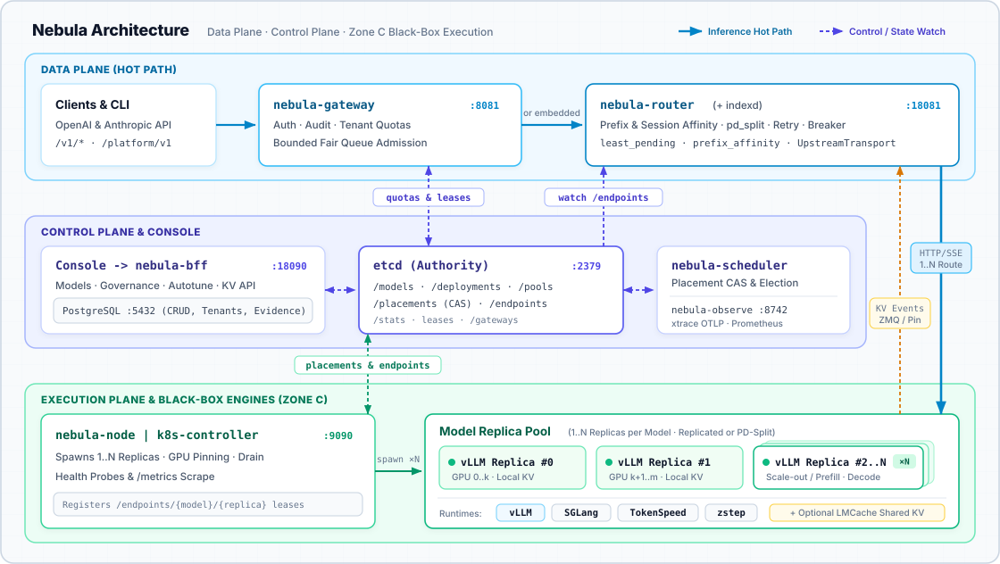

# Nebula

Nebula is a cross-engine control and data plane for on-prem / private-GPU inference. It owns declarative model lifecycle, an OpenAI- and Anthropic-compatible ingress, a programmatic `/platform/v1` control API, state-aware routing, admission control, multi-tenancy and quotas, observability, benchmarking and selection governance. The engines — **vLLM, SGLang, TokenSpeed, zstep** — keep doing the token work; Nebula orchestrates black boxes and never touches engine internals, KV bytes or per-step scheduling.

- **Current release:** workspace `1.11.0` (last tag [`v1.11.0`](docs/versions/v1.11.0.md), 2026-11-19). Work merged after that tag lives under `Unreleased` in [CHANGELOG.md](CHANGELOG.md).
- **Project docs are currently written in Chinese;** [docs/README.md](docs/README.md) is the single index. This README is the English entry point.
- **License:** Apache-2.0.

## Architecture at a glance



Control plane around the request path: `nebula-scheduler` turns `/deployments/` into versioned `/placements/`, and `nebula-node` (or the optional `nebula-k8s-controller`) executes them and registers `/endpoints/`, `/capabilities/` and `/stats/`.

- **etcd is the control-plane authority:** `/models/`, `/deployments/`, `/placements/`, `/endpoints/`, `/stats/`, `/capabilities/`, `/pools/`, leases, and live quota membership (`/gateways/`). One write owner per key space.
- **PostgreSQL owns BFF data:** console CRUD, users/RBAC, audit, tenants, benchmark v2 evidence, and guarded autotune experiments.
- **Gateway & Router hot path:** Gateway reads `/endpoints/` (plus `/tenants/` and `/gateways/` leases when multi-tenant quotas are enabled); Router selects Ready replicas from synced `/endpoints/`, CAS-versioned `/placements/` (`plan_version`), `/stats/`, and its local ZMQ KV `PrefixIndex` (optionally fed by `indexd`).
- **`NEBULA_ROUTER_MODE=embedded`** runs the router in-process (no extra HTTP hop, same KV-event runtime, opt-in; `remote` is the default).
- **Kubernetes is an optional execution plane**, not a replacement for etcd.

## Quick start

```bash
git clone --depth 1 https://github.com/EeroEternal/nebula.git
cd nebula
```

1. **Prerequisites** — Rust `1.92` (pinned in `rust-toolchain.toml`), `protoc`, etcd; PostgreSQL if you want the console/BFF. See [docs/dev/setup.md](docs/dev/setup.md).
2. **Local stack** — copy the config template, then build release binaries and start:
   ```bash
   cp deploy/nebula.env.example deploy/nebula.env
   # set START_BFF=1 and OBSERVE_AUTH_MODE=internal in deploy/nebula.env
   cargo build --workspace --release
   ./bin/nebula-up.sh      # ./bin/nebula-down.sh to stop
   ```
3. **Default ports**

   | Component | Port | Purpose |
   |---|---|---|
   | Gateway | `8081` | OpenAI/Anthropic-compatible inference API & `/platform/v1` control API |
   | Router | `18081` | standalone routing/proxy (`/healthz`, `/metrics`) |
   | Scheduler | `18082` | placement reconciler (`/healthz`, `/metrics`) |
   | BFF | `18090` | console backend (`/api`, `/api/v2`, PowerLLM compat edge) |
   | Node | `9090` | node agent HTTP API (`--api-port`); `NODE_PORT=10824` in `nebula.env` sets the base replica port |
   | Observe | `8742` | optional `nebula-observe` (`xtrace`) trace & audit server |
   | Frontend | `5173` | console (`npm run dev` in `frontend/`) |
   | etcd | `2379` | control-plane state |

4. **Auth** — inference plane uses `NEBULA_AUTH_TOKENS=dev-token:admin` (or `token:role:tenant_id`, comma-separated) with `Authorization: Bearer …`. `NEBULA_AUTH_DISABLED=1` for local development, `NEBULA_MULTI_TENANT=1` to enforce tenant admission. Details: [deployment manual](docs/manual/deployment.md).

## Repository layout

| Path | Role |
|---|---|
| `crates/nebula-common` | shared contracts: placement, endpoint, pool, capability, compat, SLO, benchmark, autotune, tenant, quota sharding, auth, queue, `UpstreamTransport`, engine args/metrics |
| `crates/nebula-meta` | MetaStore (etcd + in-memory) with election, lease and CAS |
| `crates/nebula-control` | shared control-plane service layer (deploy, inventory, pools, LMCache controller, KV APIs) used by Gateway and BFF |
| `crates/nebula-gateway` | OpenAI (`/v1/chat/completions`, `/v1/completions`, `/v1/responses`, `/v1/embeddings`, `/v1/rerank`, `/v1/score`, `/v1/models`) & Anthropic (`/v1/messages`) HTTP, `/platform/v1` control API, auth, audit, tenant/queue admission, forwarding |
| `crates/nebula-router` | replica selection, proxying, retries, circuit breaker, session affinity, KV-event `PrefixIndex`, plus the `indexd` ZMQ fanout/snapshot daemon |
| `crates/nebula-scheduler` | `/deployments/` → `PlacementPlan` (CAS), compatibility/platform/pool filtering |
| `crates/nebula-node` | watches placements, starts/stops/drains engines, registers endpoints, capabilities, stats |
| `crates/nebula-k8s-controller` | alternative execution plane: one pod per replica |
| `crates/nebula-bff` | console API: models, governance, tenants, benchmark, selection, autotune, PowerLLM console compat edge |
| `crates/nebula-observe` | observability launcher (xtrace server wrapper) |
| `crates/nebula-cli` | operator CLI |
| `frontend/` | React 19 + Vite console (models, inference, endpoints, governance, infrastructure, resources, settings) |
| `scripts/` | local CI gates, drills, benchmark runner, verification helpers |
| `bin/`, `deploy/` | stack launchers, `bin/nebula-autotune`, and environment/HA/observe examples |

## Capabilities

**Lifecycle & placement** — declarative `Deployment → PlacementPlan → Node`; `HardwarePool` (`/pools/`) constraints; multiple engine replicas per model, each on its own GPU and its own `/endpoints/{model}/{replica}` lease; per-replica `node_id` / `gpu_indices` pinning; graceful replica and whole-node drain; persistent kernel caches (`TRITON_CACHE_DIR`, `TORCHINDUCTOR_CACHE_DIR`, `FLASHINFER_WORKSPACE_BASE`); engine-specific arg encoders and capability declarations for `vllm`, `sglang`, `tokenspeed`, and `zstep` (including online APC and `dspark` / `mtp` / `ngram` speculative decoding).

**Admission & multi-tenancy** — per-model bounded fair queue with `429` instead of unbounded backlog and TTFT split into queue-wait + upstream-ttft headers; tenant RPS/concurrency/token/pin quotas; cluster quota sharding from **live Gateway membership** (`/gateways/{id}` lease), with `fail_closed` / `fail_open` degradation that is counted, never silent.

**Routing** — `least_pending`, `least_kv_cache`, `prefix_cache_aware`, `prefix_affinity` (ZeroMQ KV-event driven prefix index with optional `indexd` fanout/snapshots, wire-calibrated against the pinned vLLM image), `(tenant_id, session_id)` session affinity (`x-session-id`), plus `pd_split` role-aware full-request routing over a shared LMCache store. Every degraded path increments `*_strategy_fallback_total{reason=…}`; no silent fallback.

**KV as a tiered resource** — declare (`local_cpu_size_gb`, disk, pin budget), isolate (per replica), warm (`/lookup`, `/pin`, `/clear`, real-inference `warmup`), account (`saved_prefill_tokens_total`, conservative block accounting — no invented dollar figures). Tool-pause sessions pin their prefix spine with an explicit lease timeout.

**Reliability** — per-phase stream deadlines (first byte / idle / cross-attempt budget), pre-first-byte replica retry, one OpenAI-shaped error frame on mid-stream failure (never a fake `[DONE]`), a single `UpstreamTransport` outbound contract (`reqwest` default, optional `xlite` feature), HA-first leases/epochs with fault-injection drills ([docs/arch/ha.md](docs/arch/ha.md)).

**Observability** — Prometheus `/metrics` per component, OpenTelemetry export, xtrace-backed audit/observe API, alert examples in `deploy/observe/`.

**Governance & selection** — compatibility matrix, Model SLO with diagnostics, benchmark v2 evidence (bounded concurrency, open-loop arrivals, client TTFT/TPOT, archived manifests/hashes, SLO goodput), Roofline-scoped precision scoring, and **opt-in experimental autotuning** on isolated spare GPUs ([docs/manual/autotune.md](docs/manual/autotune.md)).

**Console** — `frontend/` only (no parallel HTML). Routes: models, inference (gateway), endpoints, governance, infrastructure (nodes / images / templates), resources (catalog / library / audit), settings.

## Verification & local CI

There is no remote test CI; the gate is local and equivalent:

```bash
./scripts/ci.sh              # fmt, clippy -D warnings, workspace tests, OpenAPI contract,
                             # UI/doc gates, benchmark protocol tests, frontend tsc+lint+build
RUN_SMOKE=1 ./scripts/ci.sh  # + release binaries and mock-engine smoke
RUN_HA_QUOTA=1 ./scripts/ci.sh  # + two-Gateway cluster quota drill
```

Targeted checks: `scripts/ha_quota_drill.sh`, `scripts/check_lmcache_compat.sh` (`--full` for the 2-GPU KV transfer proof), `scripts/verify-embedded-router.sh`, `scripts/phase0_tenant_isolation.sh`.

**Honest scope.** Measurements and rig evidence are recorded per feature in [CHANGELOG.md](CHANGELOG.md) and `docs/dev/hw/`; claims that were only unit-tested are marked as such. `pd_split` v1 is a tail-latency play, not a throughput win. Strict cluster-level quotas depend on live Gateway membership (a total etcd outage still degrades at the per-request tenant read). Autotune only touches an allowlisted set of serving parameters on spare GPUs. Serving Cell (`CellIngress`) is removed and no longer supported.

## Documentation map

| Entry | Contents |
|---|---|
| [docs/README.md](docs/README.md) | sole index; start here |
| [docs/manual/positioning.md](docs/manual/positioning.md) | product positioning, modules, terminology, delivered vs. planned |
| [docs/manual/deployment.md](docs/manual/deployment.md) | install, ports, upgrades, troubleshooting |
| [docs/manual/etcd-ha.md](docs/manual/etcd-ha.md) | production 3-node etcd topology and drills |
| [docs/arch/architecture.md](docs/arch/architecture.md) | component-level architecture |
| [docs/arch/ha.md](docs/arch/ha.md) | HA-first target: active-active, shared quotas/leases, fault injection |
| [docs/arch/vision.md](docs/arch/vision.md) / [roadmap.md](docs/arch/roadmap.md) | capability layers (L0–L4) and phased plan |
| [docs/dev/setup.md](docs/dev/setup.md) | development environment |
| [docs/dev/etcd.md](docs/dev/etcd.md) | key spaces, ownership, leases |
| [docs/dev/zstep.md](docs/dev/zstep.md) | zstep cross-repo contract (CLI, probes, SSE, metrics, KV events) |
| [docs/versions/](docs/versions/) | release notes per version |
