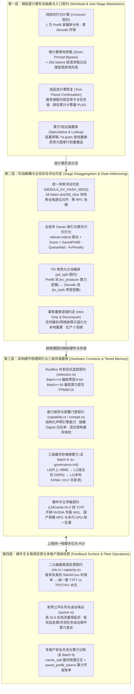

# 异构算力高效利用与细粒度计算契约方案

> 日期：2026-10-18。性质：**面向运营商 / 智算中心纯异构推理算力池的架构收敛方案**。
> 关联文档：[`direction.md`](direction.md)（Zone A–C / Stage S1–S3 边界与 MapReduce 原则）、[`kv-governance.md`](kv-governance.md)（KV Cache 一等公民分级资源治理）、[`../arch/pool.md`](../arch/pool.md)（`HardwarePool` 与 `pd_split` 角色化编排）、[`../arch/selection.md`](../arch/selection.md)（L3 智能选型）、[`prefix-affinity.md`](prefix-affinity.md)（P1c + `nebula-indexd`）。

---

## 1. 背景与核心判断：为什么容器虚拟化（K8s / HAMi）救不了大模型异构算力？

### 1.1 场景收敛：聚焦“纯异构推理算力的管理与压榨”

面向运营商与智算中心机房，底层资产的物理现实非常明确：**机房内长期并存多厂商、多代际、不同互联与主存配比的异构加速卡**（如华为昇腾 910B/910C 等国产 NPU、NVIDIA H800/A800/L40S/RTX 4090/5090 等多代 GPU，搭配大容量宿主机 DDR5 内存与本地 NVMe 磁盘）。

围绕**“如何把异构算力管得更好、有效利用率（Goodput / MFU）提得更高”**这一唯一核心目标，本方案明确**剥离三类与生产推理算力提效无关的外围概念**：
- **❌ 剥离 RSI（算子递归自改写 / 离线梦境进化）**：生产算力底座要求绝对的确定性、可审计与数值稳定，严禁线上系统自主变异改写算子内核；
- **❌ 剥离 Agent 代码执行沙箱 / RL 训练采样池**：沙箱属于上游应用侧执行环境，RL Rollout 属于后训练管线，均不属于推理算力底座职责；
- **❌ 剥离跨公有云拼凑“逻辑超算”或天价专用晶圆芯片**：聚焦自有异构机房内通用 GPU / 国产 NPU 与主机存储层级的协同压榨。

### 1.2 核心洞察：K8s 纳管与 HAMi 切卡虚拟化为什么作用有限？

传统云原生算力管理依赖 **Kubernetes 统一容器调度 + HAMi / vGPU 切卡虚拟化**。这套机制在“小模型时代（CV / 传统 NLP）”有效，但在大模型推理时代却触及了物理天花板：

1. **资源粒度错位**：
   小模型权重仅数百 MB，单张 80GB 加速卡严重过剩，因此需要切卡虚拟化（1 卡切 N 份）来提高装箱率；而主流大模型（32B / 70B / 671B MoE）仅权重与活跃 KV Cache 就占满单卡、多卡（TP4/TP8）乃至整机，根本不存在“把一张卡切碎分给多个大模型”的物理空间。
2. **对计算物理特性“失明”（Compute-Blind）**：
   K8s 与 HAMi 只认识静态的“显存字节数”和“容器进程生死”，完全看不懂大模型推理内部的**计算阶段对立（算力受限的 Prefill vs 显存带宽受限的 Decode）**，也看不懂**同一张异构卡在不同并发区间（Batch Size）下的 Roofline 效率反转**。把容器摆上去之后，算力卡依然在 Decode 阶段空转 80% 的计算单元，带宽卡依然在长文 Prefill 时被算力阻塞。
3. **对跨卡中间状态“失明”（State-Blind）**：
   大模型推理的核心中间状态是数百 MB 乃至数 GB 的 **KV Cache**。无感知的容器负载均衡会把具有相同前缀的请求随机打到不同卡上，导致全机房的异构卡都在**重复做相同的 Prefill 计算、重复存储相同的 KV 块**，把最昂贵的片上显存白白浪费掉。

> **核心结论**：
> 针对大模型异构算力的有效利用，**容器虚拟化只是最底层的进程生命周期管道；真正决定算力有效产出的，是对推理计算做更细粒度的解耦抽象，并用 Nebula 提出的「声明式物理契约与跨组件前置约定（Contracts & Invariants）」把异构卡组织成各扬所长、共享状态的协同流水线。**

---

## 2. 架构总览：基于“细粒度计算抽象 × 声明式契约”的四层收敛体系

---

## 3. 第一维：更细粒度的计算解耦抽象（让不同性质的计算各归其位）

大模型推理从来不是铁板一块的“同质计算”。要把异构卡用满，第一步是在控制面与路由层把一次笼统的推理调用**拆解为物理特征纯粹的细粒度计算原语**：

### 3.1 阶段级计算抽象：Prefill（算力密集 GEMM）vs Decode（带宽密集 GEMV）

- **底层物理矛盾**：
  - **Prefill 阶段**：并行处理完整输入序列，本质是大矩阵乘（GEMM），**算术强度极高（Compute-bound）**，瓶颈在于芯片的峰值算力（FLOPs）；
  - **Decode 阶段**：自回归逐词生成，本质是矩阵-向量乘（GEMV），每吐 1 个 token 都必须把数十 GB 模型权重和历史 KV Cache 从显存完整读一遍，**算术强度极低（Memory-bandwidth-bound）**，瓶颈完全在显存带宽与容量，此时高算力卡的 Tensor Core / Cube 单元有 **75%～85% 的时间在空转等待显存**。
- **稳态交互性增益定律**：
  当同构节点把 $75\%$ 的时间花在 Prefill、仅 $25\%$ 的时间花在 Decode 时，Decode 批次被迫承受 $4\times$ 的排队与插队膨胀；将两者物理拆分为独立池后，在总吞吐不变的前提下，单请求平均解码交互速度可获得 $\frac{1}{\text{Decode Time \%}}$ 倍（如 $2\times \sim 4\times$）的直接提升。
- **Nebula 的计算角色契约（[`model_deployment.rs`](../../crates/nebula-common/src/model_deployment.rs#L20-L34)）**：
  通过 `DeploymentTopology::PdSplit` 将副本显式抽象为两种计算角色：
  - **`ReplicaRole::Prefill`（`kv_producer`）**：部署在**算力型卡池**，专职消化长冷上下文并向共享池生产 KV 块；
  - **`ReplicaRole::Decode`（`kv_both`）**：部署在**带宽/大显存型卡池**，专职拉取暖 KV 块并维持高并发、低抖动的流式输出（真机实测稳态 TTFT p99 降低 21%、e2e p99 降低 18%）。

### 3.2 负载形态级细粒度抽象：拒绝“一刀切”流水线

并非所有请求都应当走完整的“查表 → 远程 Prefill → 跨网拉 KV → Decode”重型链路。Nebula 进一步按**计算形态与生命周期**抽象出三类特化执行契约：

| 细粒度计算原语 | 物理特征 | Nebula 契约与实现触点 | 算力提效价值 |
|---|---|---|---|
| **1. 纯前向打分计算（`/v1/score`）** | **100% Prefill、0% Decode**：分类、路由门控、RAG 重排只需 1 次前向传播获取候选词概率分布 | [`EngineCapability.score_api`](../../crates/nebula-common/src/capability.rs) + [`gate.rs`](../../crates/nebula-gateway/src/interface/gate.rs) + [`lib.rs`](../../crates/nebula-router/src/lib.rs) 前缀哈希路由 | 省去全部自回归解码步，命中前缀缓存时几毫秒即释放算力；对不支持的后端静态返回 `400 score_api_unsupported` |
| **2. 微计算原地旁路（Short-Prompt Bypass）** | **小输入冷请求（`< 256 tokens`）**：未达 LMCache 256-token 块边界，远端查表与网络传输开销大于计算本身 | [`Router::controller_warm`](../../crates/nebula-router/src/lib.rs#L723) + `NEBULA_PD_BYPASS_TOKENS=256` | 当 Decode 池有新鲜 `/stats/` 且空闲（`min_pending == 0`）时，短路 `/lookup` 直接在 Decode 节点原地完成 Chunked Prefill，消除 Prefill 池排队瓶颈 |
| **3. 挂起态计算续接（`Tool-Pause` Continuation）** | **多步断续计算**：Agent 发出 `tool_calls` 后停顿数秒至数十秒等待外部工具返回，期间数十 KB～MB 的 KV 驻留在原卡显存中 | 服务端观测 `finish_reason="tool_calls"` 登记 `(tenant_id, session_id)` 单次租约 + [`EngineQueue::acquire_with_priority`](../../crates/nebula-common/src/queue.rs#L110) | 将工具返回识别为“已投入算力（PLAS）的恢复”而非新请求：赋予有界优先唤醒并强锚定原副本，防止前序几十轮算力因排队 429 或换卡驱逐而白费 |

### 3.3 算子与验证级计算抽象：用“廉价草稿/查找”置换“昂贵大图访存”

- **物理机制**：在低并发 Decode 阶段，既然瓶颈是“每步都要搬运一次几十 GB 的主模型权重”，那么最有效的算力压榨手段就是**让每搬运一次主模型权重，能一次性并行验证出多个 token（提高平均接受长度 $\tau = 1 + \text{accepted}/\text{drafts}$）**。
- **Nebula 的声明式装配契约（[`model_request.rs`](../../crates/nebula-common/src/model_request.rs) / [`engine_args.rs`](../../crates/nebula-common/src/engine_args.rs)）**：
  将投机执行抽象为模型部署契约 `speculative_config`：
  - 支持用极低成本的 **N-gram 上下文窗口匹配（`ngram`）**、**多 Token 预测头（`mtp`）** 或 **独立小草稿模型（`draft_model`）** 先生成候选序列，再交由主模型单次前向并行验证；
  - 由 [`validate_model_config`](../../crates/nebula-common/src/capability.rs) 在部署期按后端能力做静态校验，把复杂的底层投机参数变成安全可控的平台级加速开关。

### 3.4 演进视野：异构推理控制面的本质是“物理查询优化器（Physical Query Optimizer）”

当推理请求从单一文本生成扩展到多阶段流水线（`Vision Encoder / Embedding → 长上下文 Prefill → 投机草稿 → Decode Attention / MoE FFN → Reranker / 打分`）时，不同子阶段对 **计算（FLOPs）、显存带宽（GB/s）、显存容量（GB）与卡间通信** 的压力完全不同。
Nebula 在 Zone C 层的演进方向，正是扮演关系型数据库中的 **物理查询优化器**：
- **离线部署规划（Deployment Planner，L2/L3）**：决定哪些模型权重、哪些量化精度、以什么角色（`Replicated` 或 `Prefill / Decode`）驻留在哪个异构 `HardwarePool` 上；
- **在线执行选路（Online Router，S2）**：在每个请求到达和展开时，实时权衡 **“在当前池原地计算的代价” vs “跨池/跨卡利用已有 KV 局部性（Locality）的代价”**，持续做出全局最优分派。

---

## 4. 第二维：异构卡计算能力的“物理画像与门禁契约”（屏蔽底层碎片化）

为了让运营商机房里的多厂商、多代际异构卡在同一套控制面下高效运转，同时**绝不侵入引擎内部代码（严守 Zone C 边界）**，Nebula 用三组声明式契约将异构硬件标准化：

### 4.1 Roofline 并发拐点选型契约（L3 [`selection.rs`](../../crates/nebula-common/src/selection.rs)）

同一张异构卡、同一种量化格式，在不同负载并发度下会跨过 **Roofline 算术强度拐点**，表现出截然相反的效率特征：

| 负载区间 | 物理瓶颈状态 | 量化与硬件选型规律 | Nebula L3 契约动作（`roofline_quantization_adjustment`） |
|---|---|---|---|
| **低并发交互区（`Batch <= 4`）** | **显存带宽受限（Memory-bound）**：每次权重读取仅服务 1～4 条序列 | 4-bit（W4A16/AWQ/GPTQ）将权重访存字节减半，直接带来显著解码提速 | 在 `Latency` / `Throughput` 偏好下，自动为 **4-bit 量化候选与高带宽性价比池**加分 |
| **高并发吞吐区（`Batch >= 16`）或长文 Prefill** | **计算受限（Compute-bound）**：一次权重读取分摊给 $\ge 16$ 条序列，访存被计算掩盖 | 非原生 W4A4 通路下，4-bit 每次 GEMM 前的寄存器解包（Unpack）反而增加额外算力开销；原生 **FP8 / BF16 Tensor/Cube 通路**反超 | 自动切换为 **原生 FP8（或具备原生 W4A4 硬件的池）** 加分；在 `Cost`（`$/1k tokens`）偏好下保持纯成本排序并输出可解释 `reasons` |

配合跨池切换代价评估（`switching_cost` / `switch_penalty`），L3 选型层能够根据业务的实际并发画像，把模型精准匹配到最能发挥物理效率的异构卡池。

### 4.2 引擎能力矩阵与部署期兼容门禁契约（L1 [`capability.rs`](../../crates/nebula-common/src/capability.rs) + L2 [`compat.rs`](../../crates/nebula-common/src/compat.rs#L221)）

面对国产卡与不同代际 GPU 的软件栈差异，Nebula **不在数据面热路径写任何平台 `if-else` 分支**，而是通过三道静态门禁契约在部署期完成防呆：

1. **硬件池与平台证据契约（[`HardwarePool`](../../crates/nebula-common/src/pool.rs) + [`validate_compat_for_replica_specs`](../../crates/nebula-control/src/deploy.rs)）**：
   每个节点上报真实的硬件平台标识（`platform`）、驱动版本与加速卡型号；凡是带有平台作用域的 `CompatibilityRule`，必须校验目标池节点的真实硬件证据，不满足直接阻断部署或要求显式填写 `image_override_reason` 留痕审计。
2. **镜像产物真机门禁契约（[`validate_pd_split_image`](../../crates/nebula-common/src/model_deployment.rs#L258)）**：
   异构环境下的共享 KV 组件极易因版本微差触发断言崩溃或静默退化。契约要求凡开启 `pd_split` 的部署，其容器镜像引用必须先通过 [`scripts/check_lmcache_compat.sh`](../../scripts/check_lmcache_compat.sh) 真机正数传输门禁，并列入 `NEBULA_APPROVED_PD_IMAGES` 白名单。
3. **静默特性失效巡检契约（[`engine_metrics.rs`](../../crates/nebula-common/src/engine_metrics.rs#L10) + [`compat_slo.rs`](../../crates/nebula-bff/src/compat_slo.rs)）**：
   针对部分混合注意力（Hybrid Attention）模型在异构引擎上“表面运行正常、实则静默关闭 Prefix Cache”的陷阱，控制面通过采集统一的 `vllm:prefix_cache_queries_total` 指标契约，在有流量但查询数恒为 0 时自动触发 `DiagnosticEvent` 告警。

### 4.3 硬件无关的二元曲面瓶颈反馈契约（L4 [`slo.rs`](../../crates/nebula-common/src/slo.rs) + [`capacity.rs`](../../crates/nebula-common/src/capacity.rs#L40)）

不同厂商芯片的硬件利用率指标（如 NVIDIA `DCGM_FI_DEV_GPU_UTIL` vs 昇腾 `npu_chip_info_aicore_usage`）不仅采集方式各异，而且在大模型 Decode 阶段**完全失真**（当显存带宽 100% 满载、延迟已经严重恶化时，算力核利用率往往只有 20% 左右，传统基于利用率的扩缩容彻底失效）。

Nebula 统一约定所有异构后端只向上暴露一套**与具体芯片无关的物理结果契约**：
- **算力饱和度信号**：`TTFT p95` + Prefill 池 `pending_requests` ⇒ 若违约，精准判定为**算力池不足**，输出 `scale_prefill_pool`；
- **带宽与显存饱和度信号**：`TPOT p95`（由 Router 从流式 token 间隔直方图 [`router_metrics.rs`](../../crates/nebula-control/src/router_metrics.rs) 直接测量，不依赖厂商私有指标）+ `kv_cache_usage` ⇒ 若 TPOT 违约则判定为**解码带宽不足**，若 SLO 达标但 `kv_cache_usage > 0.85` 则作为预防性容量预警（保持 `Compliant` 状态）输出 `scale_decode_pool`。

---

## 5. 第三维：跨异构单元协同的“三条核心约定（Invariants over Tight Coupling）”

在多厂商、多代际异构算力池中，最大的工程难题是：**如何在不依赖芯片私有硬件直连（如不绑 NVIDIA NVLink / NIXL）的前提下，让多张异构卡围绕 KV Cache 中间状态高效协同？**

Nebula 的解法是**用三条严格的“前置约定（Invariants）”替代运行时的跨组件强耦合**：

### 5.1 状态寻址约定：全栈确定性块哈希不变量（`NEBULA_KV_HASH_SEED` + `sha256_cbor`）

- **约定内容**：
  强制约定 Router（[`kv_hash.rs`](../../crates/nebula-router/src/kv_hash.rs#L158) / [`prompt_hash.rs`](../../crates/nebula-router/src/prompt_hash.rs#L26)）、全局索引服务 [`nebula-indexd`](../../crates/nebula-router/src/bin/indexd.rs)、以及所有异构引擎实例共享完全一致的哈希种子（`NEBULA_KV_HASH_SEED == PYTHONHASHSEED`）、块大小（16 tokens）、`sha256_cbor` 链式哈希算法与同一份 `tokenizer.json`（含 `chat_template` 渲染对齐）。
- **如何提升异构算力利用率**：
  1. **零通信定位数据（Move Compute to Data）**：Router 收到请求的瞬间，无需向任何引擎发 RPC 询问，直接在本地内存 [`PrefixIndex`](../../crates/nebula-router/src/kv_events.rs#L193) 中按算出的 8 字节块 Key 查出每张候选卡已持有的连续前缀块数 `matched_blocks`；
  2. **多卡联合代价打分（防单卡拥塞）**：通过无锁代价函数综合评估每张候选卡 $w$ 的 **“省下的 Prefill 计算量（`matched_blocks * 16`）” vs “当前排队等待代价（`pending_requests`）与显存水位惩罚（`kv_cache_usage`）”**（[`strategy.rs`](../../crates/nebula-router/src/strategy.rs)），既让全集群显存容量线性叠加，又在热点前缀突发时自动向次优空闲卡溢流（`owner_congested`）。

### 5.2 状态交换与存储置换约定：硬件中立协议（`lm://`）+ 三级缓存卸载（以存代算）

- **约定内容**：
  1. 跨卡/跨角色（Prefill → Decode）状态交换统一采用硬件无关的开源 **LMCache `lm://` 纯 TCP 协议**与 `lmcache_controller` `/lookup` 目录接口，绝不绑定 NVIDIA 专属的 NIXL 或 `p2p_nccl`；
  2. 将 KV Cache 建模为横跨 **L0（加速卡 HBM）→ L1（宿主机 DDR5 内存）→ L2（本地 NVMe 磁盘 / 远端共享池）** 的一等公民分层资源（⏳ Batch 6 待实现声明式 L1/L2 配额与单池 Offload，详见 [`kv-governance.md`](kv-governance.md)）。
- **如何提升异构算力利用率**：
  - **国产卡与异构 GPU 无缝共网**：只要跑通标准以太网 TCP 并满足张量 dtype 契约，昇腾 NPU 池与各类 GPU 池都能用同一套控制面跑通 `pd_split` 与缓存共享；
  - **用廉价主机内存/磁盘放大 10× 有效显存（⏳ Batch 6）**：运营商服务器普遍配有数百 GB 闲置主机内存与高速 NVMe，通过声明式 L1/L2 Offload 承接温/冷 KV 块，把最昂贵的加速卡片上显存腾出来跑更大并发 Batch。

### 5.3 容错与可用性约定：只发 Hint + 随时可重算（Recompute on Failure）

- **约定内容**：
  利用大模型 Prefill 阶段“给定相同 token 序列，输出 KV 张量完全确定”的**纯函数幂等特性**，约定系统中所有的跨组件状态（`nebula-indexd` 块目录、`lmcache_controller` `/lookup` 响应、`lmcache_server` 远端块、乃至 `Tool-Pause` 租约）**全部只作为性能加速偏置（Hint），绝不作为正确性依赖**。
- **如何提升异构算力利用率**：
  异构机房最常见的问题是长尾节点抖动或网络瞬断。在传统强耦合流水线中，一端抖动就会导致整条跨卡请求失败报错；而在 Nebula 的重算约定下，远端拉取失败或 `/lookup` 200ms 超时会自动回退到目标卡本地自 Prefill（Recompute），**把异构集群的“可用性事故”彻底降级为偶发的“延迟退化”，真机四项故障注入实测 100% 零拒绝（HTTP 200）**。

---

## 6. 对照总结：传统容器虚拟化 vs Nebula 细粒度计算契约体系

| 维度 | 传统云原生虚拟化方案（K8s + HAMi vGPU 切卡） | Nebula 异构计算契约与状态编排方案 |
|---|---|---|
| **核心抽象对象** | **静态容器与显存切片**（Pod / vGPU Memory MB / Core %） | **细粒度计算阶段与中间状态**（Prefill / Decode / Score / Continuation + 16-token KV Block） |
| **适用负载时代** | 小模型时代（单卡显存过剩，靠切碎单卡塞更多小模型提利用率） | **大模型时代**（单模型占满整卡/多卡，靠消除重复计算、解耦阶段瓶颈与以存代算提利用率） |
| **异构卡适配方式** | 仅负责挂载驱动设备号，对卡间算术强度与算子支持边界无感知 | **声明式物理契约**：L1 能力矩阵 + L2 兼容规则与镜像白名单 + L3 Roofline 并发拐点自动匹配 |
| **Prefill / Decode 矛盾** | 同卡混跑，算力与显存带宽互相拖累（木桶效应） | **角色化分池（`pd_split`）+ 短请求智能旁路**：算力喂算力池，带宽喂解码池，短请求原地消化 |
| **跨卡协同机制** | 无状态轮询（每张卡重复算、重复存相同前缀，或强绑厂商私有 RDMA） | **前置约定协同**：统一 `NEBULA_KV_HASH_SEED` 零通信寻址 + 硬件中立 `lm://` 共享 + 故障自动 Recompute |
| **显存容量墙突破** | 受限于物理卡 HBM 大小，满了只能加买新卡 | **以存代算（L0 HBM → L1 主机内存 → L2 本地 NVMe/远端池，⏳ Batch 6）**：用廉价主机存储将单卡等效缓存容量放大 10× |
| **容量与瓶颈度量** | 看失真的 GPU/NPU 算力利用率（`SM_UTIL` 在 Decode 满载时仅 ~25%） | **硬件无关二元曲面契约**：看 `(TTFT, TPOT, KV_Usage)` 直接定位缺算力还是缺带宽/显存 |
| **多租户共池混部** | 靠硬切卡隔离（切碎后单租户并发能力下降，闲置切片无法共享） | **全池共享 + 软硬协同治理**：有界公平队列（在线优先 + 波谷批处理填谷）+ 租户级 `cache_salt` 缓存隔离与 `Saved Tokens` 算力记账（⏳ Batch 6） |
