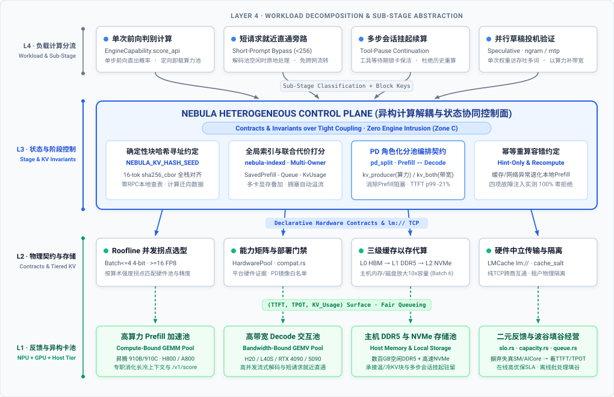

# 异构算力高效利用与细粒度计算契约方案

> 日期：2026-10-18。性质：**面向运营商 / 智算中心纯异构推理算力池的架构收敛方案**。
> 关联文档：[`direction.md`](direction.md)（Zone A–C 边界与原则）、[`kv-governance.md`](kv-governance.md)（KV Cache 一等公民分级资源治理）、[`../arch/pool.md`](../arch/pool.md)（`HardwarePool` 与 `pd_split` 角色化编排）、[`../arch/selection.md`](../arch/selection.md)（L3 智能选型）、[`prefix-affinity.md`](prefix-affinity.md)（P1c + `nebula-indexd`）。

---

## 1. 背景与核心判断：为什么容器虚拟化（K8s / HAMi）救不了大模型异构算力？

### 1.1 场景收敛：聚焦“智算中心多批次异构卡池的高效对外服务”

面向运营商与大型智算中心机房，底层算力资产的物理现实非常明确：**机房内长期并存多批次采购、多厂商、多代际、不同互联与主存配比的异构加速卡**（如华为昇腾 910B/910C 等国产 NPU、NVIDIA H800/A800/L40S/RTX 4090/5090 等多代 GPU，搭配大容量宿主机 DDR5 内存与本地 NVMe 磁盘）。

站在**智算中心算力运营与对外提供推理服务（MaaS / 托管推理池）**的视角，核心经营痛点是：**外部客户争抢高端卡，而大量国产卡与中端卡因单卡带宽或算子差异难以直接满足高 SLA 要求，同时粗放调度导致机房内部存在大量重复计算与显存空转**。围绕**“如何把机房内全量异构算力管起来、提效变现，以更低单 Token 成本承载更高外部客户并发”**这一核心目标，本方案明确**剥离三类与生产推理算力提效无关的外围概念**：
- **❌ 剥离算子递归自改写（RSI）与离线自进化**：生产算力底座要求绝对的确定性、可审计与数值稳定，严禁线上系统自主变异改写算子内核；
- **❌ 剥离 Agent 代码执行沙箱与强化学习训练采样池**：沙箱属于上游客户应用侧执行环境，强化学习采样属于后训练管线，均不属于推理算力底座职责；
- **❌ 剥离跨公有云拼凑“逻辑超算”或天价专用晶圆芯片**：聚焦自有异构机房内通用 GPU / 国产 NPU 与主机存储层级的协同压榨。

### 1.2 核心洞察：K8s 纳管与 HAMi 切卡虚拟化为什么作用有限？

传统云原生算力管理依赖 **Kubernetes 统一容器调度 + HAMi / vGPU 切卡虚拟化**。这套机制在“小模型时代（CV / 传统 NLP）”有效，但在大模型推理时代却触及了物理天花板：

1. **资源粒度错位**：
   小模型权重仅数百 MB，单张 80GB 加速卡严重过剩，因此需要切卡虚拟化（1 卡切 N 份）来提高装箱率；而主流大模型（32B / 70B / 671B MoE）仅权重与活跃 KV Cache 就占满单卡、多卡（TP4/TP8）乃至整机，根本不存在“把一张卡切碎分给多个大模型”的物理空间。
2. **对计算物理特性“失明”**：
   K8s 与 HAMi 只认识静态的“显存字节数”和“容器进程生死”，完全看不懂大模型推理内部的**计算阶段对立（算力受限的 Prefill 阶段 vs 显存带宽受限的 Decode 阶段）**，也看不懂**同一张异构卡在不同并发区间（Batch Size）下的 Roofline 效率反转**。把容器摆上去之后，算力卡依然在 Decode 阶段空转 80% 的计算单元，带宽卡依然在长文 Prefill 时被算力阻塞。
3. **对跨卡中间状态“失明”**：
   大模型推理的核心中间状态是数百 MB 乃至数 GB 的 **KV Cache**。无感知的容器负载均衡会把具有相同前缀的请求随机打到不同卡上，导致全机房的异构卡都在**重复做相同的 Prefill 计算、重复存储相同的 KV 块**，把最昂贵的片上显存白白浪费掉。

> **核心结论**：
> 针对大模型异构算力的有效利用，**容器虚拟化只是最底层的进程生命周期管道；真正决定算力有效产出的，是对推理计算做更细粒度的解耦抽象，并用 Nebula 提出的「声明式物理契约与跨组件前置约定」把异构卡组织成各扬所长、共享状态的协同流水线。**

---

## 2. 架构总览：基于“细粒度计算抽象 × 声明式契约”的四层收敛体系

```mermaid
flowchart TB
    subgraph L4_Workload["第四层（L4）：客户负载计算分流与细粒度子阶段抽象"]
        W1["单次前向判别计算 (/v1/score 契约)<br/>单步前向直出概率分布 · 零解码开销 · 定向卸载算力池"]
        W2["短请求就近直通旁路 (&lt; 256 Tokens)<br/>短请求跳过远端查表原地处理 · 免跨网流转"]
        W3["多步会话挂起续算 (外部工具调用单次租约)<br/>外部工具等待期锁卡保活与优先唤醒 · 杜绝历史重算"]
        W4["并行草稿投机验证 (ngram / mtp 核验)<br/>轻量草稿生成 + 单次权重访存批量核验 · 以算力补带宽"]
    end

    subgraph L3_StageState["第三层（L3）：全局状态寻址与读写分离控制面"]
        S1["全局统一缓存寻址 (NEBULA_KV_HASH_SEED)<br/>16-Token 块编号全栈标准统一 · 免问询直接定位缓存卡"]
        S2["多卡缓存地图与防拥塞选路 (nebula-indexd)<br/>综合权衡省下算力与排队水位 · 多卡显存拼成大池且防单卡过载"]
        S3["读写分离异构分池编排 (pd_split 契约)<br/>算力卡专职读长文 (Prefill) ↔ 带宽卡专职流式吐字 (Decode)"]
        S4["无损降级重算兜底 (缓存仅作加速提示)<br/>单卡抖动或网络超时自动退化本地计算 · 生产环境 100% 零报错"]
    end

    subgraph L2_HardwareContract["第二层（L2）：异构硬件契约与分级存储层"]
        H1["并发拐点动态适配 (Roofline 选型契约)<br/>低并发配 4-bit 高带宽池 · 高并发自动切原生 FP8/BF16 高算力池"]
        H2["异构准入与防呆门禁 (capability.rs / compat.rs)<br/>上线前核验真实卡型与验证镜像白名单 · 自动巡检缓存静默失效"]
        H3["三级存储以存代算 (⏳ Batch 6: kv-governance.md)<br/>L0(片上显存) → L1(主机 DDR5) → L2(本地 NVMe) · 放大 10x 等效显存"]
        H4["跨商互通与租户隔离 (LMCache lm:// & cache_salt)<br/>标准 TCP 协议让国产卡与 GPU 共网协同 · 租户缓存物理隔离"]
    end

    subgraph L1_FeedbackOps["第一层（L1）：异构算力底座与错峰经营层"]
        O1["高算力预填充池 + 高带宽解码池 + 主机存储池<br/>昇腾 910B/A800 啃长文 · H20/L40S 保流式吐字 · 主机 DDR5/NVMe 存温冷块"]
        O2["统一瓶颈度量与昼夜错峰填谷 (slo.rs / queue.rs)<br/>按首字/吐字延迟精准扩缩容 · 白天保高 SLA 交互 · 夜间离线批处理填谷"]
        O3["多租户安全共池与算力记账 (⏳ Batch 6)<br/>cache_salt 缓存物理正交 + saved_prefill_tokens 算力节省账单"]
    end

    L4_Workload -->|"按计算形态分流"| L3_StageState
    L3_StageState -->|"按物理契约映射硬件与存储"| L2_HardwareContract
    L2_HardwareContract <-->|"上报统一物理水位与 ROI"| L1_FeedbackOps
```

---

## 3. 第四层（L4）：负载计算分流与细粒度子阶段抽象（让不同性质的客户负载各归其位）

大模型推理从来不是铁板一块的“同质计算”。站在智算中心对外服务的视角，如果把外部客户千差万别的业务流量全部塞进同一条重型生成流水线，不仅会造成严重的算力错配，还会让大量非主力卡无法发挥价值。Nebula 在控制面与路由入口将笼统的推理调用**拆解为物理特征纯粹的四类细粒度计算机制**：

### 3.1 阶段级计算解耦：Prefill（算力密集 GEMM）vs Decode（带宽密集 GEMV）

- **底层物理矛盾**：
  - **Prefill（首字阅读阶段）**：并行处理完整输入上下文，本质是大矩阵乘（GEMM），**算术强度极高（受限于峰值算力）**，瓶颈在于芯片的浮点运算能力（FLOPs）；
  - **Decode（逐词生成阶段）**：自回归逐词输出，本质是矩阵-向量乘（GEMV），每生成 1 个 Token 都必须把数十 GB 模型权重和历史 KV Cache 从显存完整读取一遍，**算术强度极低（受限于显存带宽）**，瓶颈完全在显存带宽与容量，此时高算力卡的计算单元有 **75%～85% 的时间在空转等待显存搬运**。
- **稳态交互性增益定律**：
  当同构节点把 $75\%$ 的时间花在 Prefill、仅 $25\%$ 的时间花在 Decode 时，Decode 批次被迫承受 $4\times$ 的排队与插队膨胀；将两者物理拆分为独立池后，在总吞吐不变的前提下，单请求平均解码交互速度可获得 $\frac{1}{\text{Decode 时间占比}}$ 倍（如 $2\times \sim 4\times$）的直接提升。
- **Nebula 的计算角色契约（[`model_deployment.rs`](../../crates/nebula-common/src/model_deployment.rs#L20-L34)）**：
  通过 `DeploymentTopology::PdSplit` 将副本显式抽象为两种计算角色，使机房内不同特性的加速卡各司其职：
  - **`ReplicaRole::Prefill`（`kv_producer`）**：部署在**算力充裕的卡池（如国产昇腾 910B / A800）**，专职消化客户长文档上下文并向共享池生产 KV 块；
  - **`ReplicaRole::Decode`（`kv_both`）**：部署在**高显存带宽/大显存卡池（如 H20 / L40S）**，专职拉取暖 KV 块并维持高并发、低抖动的流式输出（真机实测稳态 TTFT p99 降低 21%、端到端 p99 降低 18%）。

### 3.2 负载形态级细粒度分流：拒绝“一刀切”消耗机房资源

针对外部客户的不同调用形态，Nebula 拒绝让所有请求都走完整的“全局查表 → 远程 Prefill → 跨网传 KV → Decode”重型链路，而是通过三项精准分流契约消除无效开销：

| 细粒度计算机制 | 机制原理（直观严谨定义） | Nebula 契约与实现触点 | 智算中心对外服务经营收益 |
|---|---|---|---|
| **1. 单次前向判别计算** （`/v1/score` 契约） | **只做 1 次前向阅读、不做逐词生成（100% Prefill、0% Decode）**：客户在做检索重排（Rerank）、意图路由、合规审核时，只需获取候选词概率分布，无需进入自回归解码循环 | [`EngineCapability.score_api`](../../crates/nebula-common/src/capability.rs) + [`gate.rs`](../../crates/nebula-gateway/src/interface/gate.rs) + [`lib.rs`](../../crates/nebula-router/src/lib.rs) 前缀哈希路由 | **省去 100% 解码访存开销，单卡吞吐提升 10×+**：将外部客户的判别/打分流量从高价解码池剥离，定向卸载至算力充裕的国产 NPU 池批量高吞吐处理 |
| **2. 短请求就近直通旁路** （输入 `< 256 Tokens`） | **短输入免跨池折腾**：未达 LMCache 256-Token 块边界的短请求，跨节点查表与网络传输耗时反而高于计算本身；当解码池空闲时直接原地完成计算 | [`Router::controller_warm`](../../crates/nebula-router/src/lib.rs#L723) + `NEBULA_PD_BYPASS_TOKENS=256` | **长短客流智能分道**：短对话客户获得毫秒级首字响应，同时避免海量碎请求挤占机房内网带宽与长文 Prefill 算力池 |
| **3. 多步会话挂起续算** （外部工具调用单次租约） | **外部工具调用等待期“锁卡保活”**：企业客户的 Agent 工作流在发出 `tool_calls` 后会停顿数秒等待外部 API 返回；网关自动在原卡登记单次租约，工具返回后优先放行并精准送回原卡续算 | 服务端观测 `finish_reason="tool_calls"` 登记 `(tenant_id, session_id)` 单次租约 + [`EngineQueue::acquire_with_priority`](../../crates/nebula-common/src/queue.rs#L110) | **杜绝换卡导致的数万字历史上下文返工重算**：保护已投入算力（PLAS），消除 Agent 客户多轮交互中 50%～80% 的无效重复 Prefill，使同等卡数可承载的并发企业客户数翻倍 |

### 3.3 算子与验证级置换：并行草稿投机验证（以算力补带宽）

- **机制原理（用冗余算力置换紧缺显存带宽）**：
  在对外交付低延迟生成服务时，机房内大量中端卡或异构卡受限于显存带宽（每吐 1 个词都要完整搬运一次数十 GB 模型权重，而高达 80% 的算力核处于闲置等待状态），导致单流吐字速度（TPOT）难以达到高价值客户的 SLA 门槛。
  **并行草稿投机验证**通过极轻量的 **上下文窗口匹配（`ngram`）**、**多 Token 预测头（`mtp`）** 或 **轻量草稿模型（`draft_model`）** 先快速预测后续多个候选词，再利用主模型原本闲置的算力**仅读取 1 次显存权重即一次性并行核验多个词**（将单次权重访存的有效产出提升至 $\tau = 1 + \text{命中词数}/\text{草稿词数}$）。
- **Nebula 声明式装配契约与经营价值（[`model_request.rs`](../../crates/nebula-common/src/model_request.rs) / [`engine_args.rs`](../../crates/nebula-common/src/engine_args.rs)）**：
  通过 `speculative_config` 统一声明并由 [`validate_model_config`](../../crates/nebula-common/src/capability.rs) 在部署期按后端能力做静态校验。在不损失任何生成精度的前提下，**将显存带宽受限卡型的单流解码速度提升 1.5～2.5 倍，帮助智算中心把原本难以单独售卖的中端异构卡转化为满足高 SLA 标准的高溢价服务能力**。

### 3.4 演进视野：异构推理控制面的本质是“物理查询优化器”

当推理请求从单一文本生成扩展到多阶段流水线（`视觉编码 / 向量化 → 长上下文 Prefill → 投机草稿 → Decode 注意力与专家层 → 重排打分`）时，不同子阶段对 **浮点算力（FLOPs）、显存带宽（GB/s）、显存容量（GB）与卡间通信** 的压力完全不同。
Nebula 在 Zone C 层的演进方向，正是扮演关系型数据库中的 **物理查询优化器**：
- **离线部署规划（L2 / L3）**：决定哪些模型权重、哪些量化精度、以什么角色（单池副本或 `Prefill / Decode` 分池）驻留在哪个异构 `HardwarePool` 上；
- **在线执行选路（S2）**：在每个请求到达和展开时，实时权衡 **“在当前池原地计算的代价” vs “跨池/跨卡利用已有缓存局部性的代价”**，持续做出全局最优分派。

---

## 4. 第三层（L3）：全局状态寻址与读写分离控制面（消灭多卡重复计算与慢卡抖动）

在多厂商、多代际异构算力池中，如果多张加速卡之间无法高效共享中间计算状态（KV Cache），同一企业客户的公共系统提示词和行业知识库就会在几十张卡上被反复重算。Nebula **不依赖特定芯片厂商的私有硬件直连（如不绑 NVIDIA NVLink）**，而是通过四项控制面机制实现跨卡高效协同：

| L3 控制面核心机制 | 机制原理（直观严谨定义） | Nebula 契约与实现触点 | 智算中心对外服务经营收益 |
|---|---|---|---|
| **1. 全局统一缓存寻址** （`NEBULA_KV_HASH_SEED`） | **全栈统一数据块编号标准**：网关、索引服务与所有异构引擎共享完全一致的 16-Token 块切分、哈希种子（`NEBULA_KV_HASH_SEED == PYTHONHASHSEED`）、`sha256_cbor` 算法与分词模板，网关无需发任何跨节点查询报文即可直接算出请求对应的块编号 | [`kv_hash.rs`](../../crates/nebula-router/src/kv_hash.rs#L158) + [`prompt_hash.rs`](../../crates/nebula-router/src/prompt_hash.rs#L26) | **“把计算精准派往已有缓存的卡”**：毫秒级定位已持有客户历史前缀的加速卡，消灭多卡重复 Prefill 计算，显著降低单请求算力消耗 |
| **2. 多卡缓存地图与防拥塞选路** （`nebula-indexd` 联合打分） | **全局缓存目录 + 容量/排队联合权衡**：实时维护全集群每张卡持有的缓存块地图（[`PrefixIndex`](../../crates/nebula-router/src/kv_events.rs#L193)），选路时综合计算 `省下的预填充算力 - 当前排队等待 - 显存水位惩罚`，在命中缓存与负载均衡之间自动寻优 | [`nebula-indexd`](../../crates/nebula-router/src/bin/indexd.rs) + [`strategy.rs`](../../crates/nebula-router/src/strategy.rs) | **“多卡显存拼成逻辑大池，高峰期防单卡堵死”**：既让全集群显存容量线性叠加，又在热门客户流量突发时自动向次优空闲卡分流（`owner_congested`），杜绝单卡排队违约 |
| **3. 读写分离异构分池编排** （`pd_split` 契约） | **算力池与带宽池物理分离**：将长文档阅读（Prefill，`kv_producer`）与流式吐字（Decode，`kv_both`）拆入不同硬件池独立扩缩容，消除同卡混跑时的计算与访存互相阻塞 | [`model_deployment.rs`](../../crates/nebula-common/src/model_deployment.rs#L20-L34) + [`Router::controller_warm`](../../crates/nebula-router/src/lib.rs#L723) | **“好钢用在刀刃上，国产算力卡与高带宽卡协同变现”**：用充裕的国产算力卡专门消化长文，用高带宽卡专门保交互吐字，首字延迟 TTFT p99 实测降低 21% |
| **4. 无损降级重算兜底** （缓存仅作加速提示） | **缓存仅作加速提示、异常自动退化本地计算**：利用大模型前向计算的幂等性，将一切跨卡缓存目录与传输仅视为性能加速提示；遇网络抖动或 200ms 查表超时，目标卡立即无缝退化为本地自计算 | [`lib.rs`](../../crates/nebula-router/src/lib.rs) 容错回退状态机 | **“屏蔽异构机房硬件毛刺，保障电信级 99.99% 可用性”**：将异构集群常见的单点抖动从“客户报错中断”降级为偶发的“毫秒级延迟波动”，真机四项故障注入实测 **100% 零报错拒绝** |

---

## 5. 第二层（L2）：异构硬件契约与分级存储层（屏蔽硬件差异、突破显存容量墙）

为了让机房里不同时期采购的国产 NPU 与多代 GPU 在同一套平台下稳定混部，同时**绝不侵入底层引擎代码（严守 Zone C 边界）**，Nebula 通过四项声明式硬件与存储契约向下纳管算力：

### 5.1 并发拐点动态适配（`Roofline` 算术强度选型契约，[`selection.rs`](../../crates/nebula-common/src/selection.rs)）

同一张异构卡、同一种量化格式，在客户业务的不同并发批次（Batch Size）下会跨过 **Roofline 算术强度拐点**，表现出截然相反的效率特征：

| 客户业务并发区间 | 硬件物理瓶颈 | 最优硬件池与量化匹配规律 | 智算中心经营收益（配合 `switching_cost` / `switch_penalty`） |
|---|---|---|---|
| **低并发实时交互区（`Batch <= 4`）** | **受限于显存带宽**：每次权重搬运仅服务 1～4 个并发请求 | **4-bit 量化（W4A16/AWQ/GPTQ）** 将权重读取字节减半，直接带来显著解码提速 | 自动优先匹配 **4-bit 量化与高带宽性价比卡池**，以更低硬件成本交付极速交互体验 |
| **高并发吞吐区（`Batch >= 16`）或长文阅读** | **受限于峰值算力**：一次权重读取分摊给 $\ge 16$ 个请求，访存被计算掩盖 | 非原生 W4A4 下 4-bit 实时解包反而消耗额外算力；**原生 FP8 / BF16 矩阵核**反超 | 自动切换至 **原生 FP8/BF16 高算力卡池**，避免高并发下算力被解包操作拖慢，最大化整机吞吐 |

### 5.2 异构准入与防呆门禁（[`capability.rs`](../../crates/nebula-common/src/capability.rs) + [`compat.rs`](../../crates/nebula-common/src/compat.rs#L221)）

面对国产卡与不同代际 GPU 的驱动、镜像和算子支持差异，Nebula 通过三道上线前门禁与巡检契约消除运维事故：
1. **真实硬件证据核验（[`HardwarePool`](../../crates/nebula-common/src/pool.rs) + [`validate_compat_for_replica_specs`](../../crates/nebula-control/src/deploy.rs)）**：节点自动上报硬件平台（`platform`）、驱动与卡型；部署时强制核验目标池的真实硬件证据，不兼容配置直接拦截或要求审计留痕（`image_override_reason`）。
2. **验证镜像白名单门禁（[`validate_pd_split_image`](../../crates/nebula-common/src/model_deployment.rs#L258)）**：凡开启跨卡读写分离（`pd_split`）的部署，其镜像必须先通过 [`scripts/check_lmcache_compat.sh`](../../scripts/check_lmcache_compat.sh) 真机正数传输门禁并列入 `NEBULA_APPROVED_PD_IMAGES` 白名单，杜绝版本微差导致线上崩溃。
3. **缓存静默失效自动巡检（[`engine_metrics.rs`](../../crates/nebula-common/src/engine_metrics.rs#L10) + [`compat_slo.rs`](../../crates/nebula-bff/src/compat_slo.rs)）**：针对部分混合注意力模型在异构引擎上“表面正常响应、实则暗中关闭前缀缓存”的隐患，平台持续巡检 `vllm:prefix_cache_queries_total` 指标，异常归零时自动发出 `DiagnosticEvent` 运维告警。

### 5.3 三级存储以存代算与跨商互通（[`kv-governance.md`](kv-governance.md)，⏳ Batch 6）

- **三级存储以存代算（`L0 显存 → L1 主存 → L2 闪存`）**：
  智算中心服务器普遍标配数百 GB 闲置主机 DDR5 内存与数 TB 高速 NVMe 闪存。Nebula 将 KV Cache 建模为横跨 **L0（加速卡片上显存）→ L1（宿主机 DDR5 内存）→ L2（本地 NVMe 磁盘 / 共享存储池）** 的分级资源（⏳ Batch 6），用廉价主机存储将单卡等效缓存容量**放大 10 倍**，无需追加购买昂贵显卡即可承载大规模企业知识库与长会话驻留。
- **跨厂商通用传输与租户物理隔离（`LMCache lm://` + `cache_salt`）**：
  跨卡状态传输统一采用标准以太网纯 TCP 协议（`lm://`），不绑定特定芯片厂商私有硬件协议（如 NIXL），让**国产昇腾 NPU 与各类 GPU 能够一网互通**；同时通过租户级密码学盐值（`cache_salt`，⏳ Batch 6）对不同企业客户的缓存块做物理正交隔离，满足政企客户严苛的数据安全合规要求。

---

## 6. 第一层（L1）：异构算力底座与昼夜错峰经营（看得准瓶颈、填得满波谷）

### 6.1 统一瓶颈度量：用客户体感指标替代失真的硬件利用率（[`slo.rs`](../../crates/nebula-common/src/slo.rs) + [`capacity.rs`](../../crates/nebula-common/src/capacity.rs#L40)）

不同厂商芯片的底层利用率指标（如 NVIDIA `DCGM_FI_DEV_GPU_UTIL` vs 昇腾 `npu_chip_info_aicore_usage`）不仅口径不一，而且在大模型解码阶段**严重失真**——当显存带宽 100% 满载、客户吐字已经明显卡顿时，算力核利用率往往只有 20% 左右，导致传统基于 GPU 利用率的告警与扩缩容彻底失效。

Nebula 统一采用**与具体芯片无关的三维服务水位契约 `(TTFT, TPOT, KV_Usage)`**：
- **首字延迟（`TTFT p95`）+ 预填充排队数超标** ⇒ 精准判定为**算力池不足**，自动触发算力池扩容（`scale_prefill_pool`）；
- **吐字间隔（`TPOT p95`，由网关直接测量流式间隔 [`router_metrics.rs`](../../crates/nebula-control/src/router_metrics.rs)）超标或显存水位 `kv_cache_usage > 0.85`** ⇒ 精准判定为**解码带宽或显存容量不足**，提前触发解码池预警或扩容（`scale_decode_pool`）。

### 6.2 昼夜错峰填谷与算力节省记账（[`queue.rs`](../../crates/nebula-common/src/queue.rs) + ⏳ Batch 6）

- **有界公平队列与波谷填谷**：通过分级优先级队列，白天高峰期优先保障高溢价在线交互客户的低延迟 SLA；夜间或算力波谷期自动放行批量文档处理、离线评测与数据清洗任务，将机房 24 小时平均算力利用率拉满。
- **算力节省可视化记账（`saved_prefill_tokens`，⏳ Batch 6）**：实时统计因缓存命中与阶段分流为机房省下的重算 Token 总量与等效 GPU 时长，让智算中心的每一分优化收益都清晰可查。

---

## 7. 全景对照总结：传统容器虚拟化 vs Nebula 异构计算契约与状态编排体系

| 维度 | 传统云原生虚拟化方案（K8s + HAMi vGPU 切卡） | Nebula 异构计算契约与状态编排方案 |
|---|---|---|
| **核心管理颗粒度** | **静态容器与显存切片**（只管 Pod 生死与显存 MB 切分） | **细粒度计算阶段与中间状态**（单步判别 / 短请求直通 / 会话续算 / 投机核验 + 16-Token 缓存块） |
| **适用业务形态** | 小模型时代（单卡显存过剩，靠切碎单卡塞更多小模型提装箱率） | **大模型服务时代**（单模型占满整卡/多卡，靠消除重复计算、读写分离与以存代算提并发吞吐） |
| **非主力/国产卡变现能力** | 客户挑卡严重，中端卡与异构卡因单卡性能短板难以售卖 | **扬长避短协同变现**：国产算力卡专职长文预填充与批量判别，中端卡靠投机核验拉升吐字速度达到高 SLA |
| **长短请求与读写矛盾** | 同卡混跑、一刀切转发，长文阅读阻塞流式吐字，碎请求挤占内网 | **读写分离（`pd_split`）+ 短请求就近直通**：算力喂算力池、带宽喂解码池、短消息原地秒结 |
| **跨卡协同与防呆机制** | 无状态轮询（多卡重复计算相同前缀），上线靠人工试错排障 | **全局统一哈希寻址 + 异构准入门禁**：零通信定位缓存卡、自动防拥塞分流、上线前拦截不兼容镜像 |
| **硬件故障容错能力** | 单点慢卡或网络抖动直接导致跨卡流水线报错中断 | **无损降级重算（缓存仅作加速提示）**：异常 200ms 内自动退化本地计算，生产环境 **100% 零报错** |
| **显存容量墙突破** | 受限于加速卡片上显存大小，显存满载只能追加采购新卡 | **三级存储以存代算（L0 显存 → L1 主存 → L2 闪存，⏳ Batch 6）**：用廉价服务器内存/硬盘放大 10× 等效显存 |
| **瓶颈度量与多租户经营** | 看失真的算力利用率（解码满载时算力仅 ~25%），靠硬切卡隔离租户 | **看真实体感水位 `(TTFT, TPOT, KV_Usage)`**：精准识别算力/带宽瓶颈，支持昼夜错峰填谷与租户级缓存安全共池（⏳ Batch 6） |
