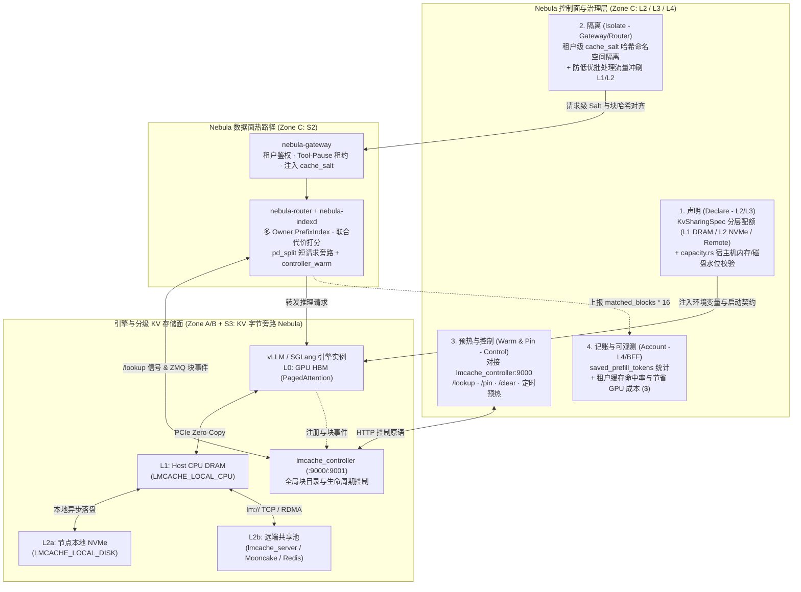

# 企业级 KV Cache 资源化治理设计（Tiered Resource Governance）

> 日期：2026-10-18。性质：**架构设计与演进契约（Batch 6）**。
> 关联文档：[`direction.md`](direction.md)（Zone A–C / Stage S1–S3 边界与 2026 趋势映射）、[`landscape.md`](landscape.md)（主流编排框架对比）、[`prefix-affinity.md`](prefix-affinity.md)（P1c + `nebula-indexd`）、[`../arch/pool.md`](../arch/pool.md)（`pd_split` 共享 KV 角色化编排）、[`../arch/vision.md`](../arch/vision.md)（L0–L4 能力分层）。

---

## 1. 核心定位升级：把 KV Cache 从“选路信号”升级为“控制面一等公民资源”

在完成了 P1c 前缀亲和、`nebula-indexd` 全局索引、`pd_split` v1 角色化路由与 Batch 5（短请求旁路、多 Owner 联合代价打分、`Tool-Pause` 租约保护）之后，Nebula 对 KV Cache 的认知经历了三代演进：

| 阶段 | 对 KV Cache 的抽象 | 核心机制 | 局限性 |
|------|-------------------|----------|--------|
| **Gen 1：无状态负载均衡（Stateless LB）** | **不可见（黑盒）** | `RoundRobin` / `LeastPending` 盲目均摊 | 每个副本重复 Prefill、重复存储相同前缀，集群有效缓存容量除以 $N$ |
| **Gen 2：信号驱动选路（Signal-Driven Routing，已落地）** | **Router 侧的只读路由信号（`warm/cold` + 块匹配深度）** | ZMQ `BlockStored` 事件 + [`PrefixIndex`](../../crates/nebula-router/src/kv_events.rs#L193) + [`Router::controller_warm`](../../crates/nebula-router/src/lib.rs#L723) `/lookup` | 控制面（L2/L3/L4）对缓存容量分层、租户隔离、主动预热、生命周期与成本节省缺乏主动治理能力 |
| **Gen 3：一等公民分层资源（Tiered Resource Governance，本文目标）** | **横跨 L2/L3/L4 的可声明、可隔离、可预热、可记账资源** | **声明（Declare）**L0/L1/L2 容量 → **隔离（Isolate）**租户命名空间 → **预热/钉死（Warm/Pin）**核心前缀 → **记账（Account）**节省算力与成本 | 在严守 Zone C / S3 边界（KV 字节流永不经手 Nebula）的前提下，闭环企业级缓存数据管理 |

> **核心定位演进命题**：
> 1. **数据面（Router / Gateway）**：把多副本推理从“无状态的盲目均摊”，变成**“围绕 KV Cache 中间状态的数据亲和与阶段化解耦调度（State- & Stage-Aware Orchestration）”**；
> 2. **控制面（L2 / L3 / L4）**：**不要把 KV Cache 只当成 Router 选路时的一个只读布尔信号（`warm/cold`），而要把它当成 Nebula 控制面的一等公民分层资源（Tiered Resource）来声明（Declare）、隔离（Isolate）、预热（Warm/Pin）和记账（Account）。**

---

## 2. 外部参照：Tensormesh Platform 与开源生态深度拆解

### 2.1 Tensormesh Platform 是什么？

**Tensormesh Platform** 是开源 **LMCache** 团队（University of Chicago 背景，Junchen Jiang、Yihua Cheng、Kuntai Du 等）于 2026 年 9–10 月正式推出的商业化企业级产品（2026 年 5 月完成约 2000 万美元融资，投资方含 AMD Ventures、CoreWeave、NVentures 等）。其核心定位是 **AI 推理的数据管理平面（Data Management Layer for AI Inference）**——不替代 vLLM/SGLang 等推理引擎，而是在引擎之上提供生产级的 KV Cache 放置、共享、淘汰、安全和治理能力。

#### （1）核心部署与组件形态
以 Kubernetes 部署为主（`Helm + Operator`），包含四个核心部分：
- **Operator（Controller）**：管理整个缓存基础设施生命周期；
- **Cache Engine（DaemonSet，每 GPU 节点一个）**：负责在节点侧存储与服务 KV 块；
- **Coordinator**：跨节点缓存位置感知与全局协调（对应开源 `lmcache_controller` 的商业增强版）；
- **Observability + UI/CLI**：OpenTelemetry 指标/追踪输出（Prometheus/Tempo）+ Operator 控制台与 CLI。

#### （2）L0 / L1 / L2 三层缓存自动管理
平台根据工作负载和命中率目标，自动决定 KV 块在三层存储介质间的放置、晋升与溢出策略：

| 层级 | 物理介质 | 职责定位 | 延迟与容量特征 |
|------|----------|----------|----------------|
| **L0** | **GPU HBM** | 当前活跃推理请求 | 带宽最高（TB/s 级）、容量最小（由 vLLM `PagedAttention` 直接管理） |
| **L1** | **Host CPU DRAM** | 节点热数据集 Offload | 次快（PCIe Gen5 ~64 GB/s），默认开启，可按节点配置 GB 级配额 |
| **L2** | **外部存储（本地 NVMe / NFS / 远端池 / 对象存储）** | 大容量温/冷数据持久化与跨实例共享 | 成本最低、容量百 GB～TB 级，**支持引擎实例重启后跨生命周期复用** |

#### （3）关键技术特性与企业级增量
1. **Prefix Caching + Multi-Tier Offload**：标准前缀复用并自动溢出到 L1/L2，突破单卡 HBM 容量上限；
2. **Non-Prefix Caching（CacheBlend，EuroSys 2025 Best Paper）**：针对 RAG 多文档拼接且顺序不固定的场景，复用非前缀位置的文档 KV 块，并仅对跨块边界 ~10%–15% 的高偏差 token 做选择性重算（Selective Recompute）；**目前主要验证于 Dense 模型**；
3. **Peer-to-Peer（跨节点共享）与 P/D 分离**：支持跨节点拉取兼容 KV（RDMA 优先，TCP 回退）及原生 Prefill/Decode 分离；
4. **高级生命周期控制 API**：通过控制面 API 支持按工作负载或集群粒度执行 **`pin`（钉死防淘汰）、`lookup`（查询）、`move`（跨层迁移）、`compress`（压缩）、`clear`（清理）**；
5. **相对纯开源 LMCache 的五大企业级增量**：
   - **安全与隔离**：跨层级数据保护（含 L2 落盘加密）、多租户逻辑隔离；
   - **可观测与 ROI 度量**：实时命中率、TTFT 降幅、等效节省算力成本可视化；
   - **高可用与韧性**：Coordinator / Operator / Cache Engine / vLLM Pod 杀伤自动恢复与降级验证；
   - **策略管理**：租户配额、分级淘汰策略可控；
   - **Day-1 / Day-2 运维体验**：Operator UI + CLI。

### 2.2 四方横向对比：开源 LMCache vs Mooncake Store vs Tensormesh vs Nebula

| 维度 | **纯开源 LMCache + 后端**（Valkey / 本地盘等） | **Mooncake Store**（Moonshot AI / Kimi 开源） | **Tensormesh Platform**（商业版） | **Nebula（当前主干 + Batch 6 目标）** |
|------|-----------------------------------------------|-----------------------------------------------|-----------------------------------|---------------------------------------|
| **核心定位** | 引擎进程内 KV 连接器与分层/传输库 | KVCache-centric 高性能分布式存储与 RDMA 传输引擎 | K8s 专属的商业化 KV Cache 数据管理平面 | **无需 K8s / K8s 双栈的跨引擎推理控制面 + 企业级 KV 资源治理** |
| **L0/L1/L2 分层与跨节点共享** | ✅ 强（已内置 CPU DRAM、Local Disk、`lm://`、NIXL、Mooncake 后端） | ✅ 极强（DRAM/SSD 分布式池 + RDMA 拓扑感知传输） | ✅ 基于开源 LMCache 封装自动策略 | ✅ 已集成开源 `LMCacheConnectorV1` + `lmcache_server`；**Batch 6 开放声明式 L1/L2 容量编排** |
| **非前缀复用（CacheBlend）** | ✅ 已在开源 LMCache 上游提供（限 Dense 模型） | 有限（以 Prefix / 块级 KV 传输为主） | ✅ 原生强化并提供策略配置 | ⏳ **仅在 L2 `engine_args` 暴露可选开关 + 兼容矩阵拦截非 Dense 模型** |
| **企业治理（多租户/安全隔离/配额）** | ❌ 需自建 | ❌ 需自建（偏底层存储基础设施） | ✅ 商业版核心卖点 | ✅ **Nebula 原生强项（租户配额/公平队列/审计），Batch 6 补齐租户 `cache_salt` 隔离** |
| **成本归因与 ROI 可观测** | ❌ 仅暴露底层 Prometheus counter | ❌ 仅暴露传输与命中指标 | ✅ 商业仪表盘（展示命中率与成本收益） | ✅ **已有 BFF 计费与 `PrefixIndex` 块统计，Batch 6 联动输出 `Saved Prefill Tokens` 与节省金额** |
| **底座依赖与运维体验** | 手工配置环境变量与启动脚本 | 配置与脚本为主 | **强绑 K8s（Helm + Operator）**，商业闭源许可 | **etcd 单一权威，单二进制裸机（`nebula-node`）与 K8s 双执行面统一托管** |

### 2.3 对 Nebula 的核心洞察：借开源之“力”，铸治理之“魂”

拆解 Tensormesh Platform 可以得出两条极其重要的工程判断：
1. **底层数据面原语 90% 已在开源 LMCache 中就绪**：包括 `LMCACHE_LOCAL_CPU`（L1）、`LMCACHE_LOCAL_DISK`（L2）、`lmcache_server`（远端共享层）以及 `lmcache_controller`（端口 `9000`）原生的 `/lookup`、`/pin`、`/clear`、`/move`、`/compress` 接口。Nebula **完全不需要重复造存储轮子（S3）**。
2. **Tensormesh 真正收费的“企业治理与运维层”，恰好有 70% 落在 Nebula 已建成的 L2/L3/L4 控制面骨架上**：Nebula 已经有模型部署规格（[`ModelDeployment`](../../crates/nebula-common/src/model_deployment.rs#L71)）、L3 容量与选型（[`capacity.rs`](../../crates/nebula-common/src/capacity.rs#L40) / [`selection.rs`](../../crates/nebula-common/src/selection.rs)）、多租户准入队列（[`queue.rs`](../../crates/nebula-common/src/queue.rs#L110)）、兼容矩阵（[`compat.rs`](../../crates/nebula-common/src/compat.rs#L221)）以及 BFF 审计计费。**只要把 KV Cache 作为一等公民资源接入这四层，Nebula 就能在不依赖 K8s、零商业锁定的前提下，提供完整的企业级 Cache 治理体验。**

---

## 3. 架构全景：L0/L1/L2 存储介质 × Nebula 控制面治理映射



---

## 4. 五大企业级 KV 资源化治理能力设计（Batch 6）

### 4.1 声明（Declare）：L0/L1/L2 分层缓存声明式编排与 L3 容量联动

#### 现状与痛点
1. 在 [`crates/nebula-common/src/model_deployment.rs`](../../crates/nebula-common/src/model_deployment.rs#L39-L45) 中，[`KvSharingSpec`](../../crates/nebula-common/src/model_deployment.rs#L39) 目前仅包含 `remote_url` 与 `serde` 两个字段；
2. 在 [`kv_sharing_env()`](../../crates/nebula-common/src/model_deployment.rs#L179-L195) 中，`LMCACHE_LOCAL_CPU="True"` 与 `LMCACHE_MAX_LOCAL_CPU_SIZE="5"`（固定 5 GB）是硬编码的，且当 `role == ReplicaRole::Mixed`（即普通 `replicated` 拓扑）时直接返回空数组，导致**占生产绝大多数的单池 `replicated` 部署无法利用宿主机百 GB 内存（L1）和本地 NVMe（L2）做 Prefix Cache 扩容与重启保留**。

#### 改造方案與代码触点
- **触点**：
  - [`crates/nebula-common/src/model_deployment.rs`](../../crates/nebula-common/src/model_deployment.rs#L39)（`KvSharingSpec` / `kv_sharing_env` / `kv_transfer_config`）
  - [`crates/nebula-common/src/capacity.rs`](../../crates/nebula-common/src/capacity.rs#L40)（`build_capacity_snapshot`）
- **数据结构演进（向后兼容 `serde(default)`）**：
  ```rust
  #[derive(Debug, Clone, Serialize, Deserialize, PartialEq, Eq)]
  pub struct KvSharingSpec {
      /// Optional in replicated local-offload mode; required (`lm://...`) in pd_split mode.
      #[serde(default, skip_serializing_if = "Option::is_none")]
      pub remote_url: Option<String>,
      #[serde(default = "default_kv_serde")]
      pub serde: String,
      /// L1 Host CPU DRAM cache quota in GiB per replica (`LMCACHE_MAX_LOCAL_CPU_SIZE`, default 5).
      #[serde(default = "default_local_cpu_size_gb")]
      pub local_cpu_size_gb: u32,
      /// L2 Local NVMe offload directory (`LMCACHE_LOCAL_DISK`, e.g. "/mnt/nvme/lmcache").
      #[serde(default, skip_serializing_if = "Option::is_none")]
      pub local_disk_path: Option<String>,
      /// L2 Local NVMe quota in GiB per replica (`LMCACHE_MAX_LOCAL_DISK_SIZE`).
      #[serde(default, skip_serializing_if = "Option::is_none")]
      pub local_disk_size_gb: Option<u32>,
  }
  ```
- **行为契约**：
  1. **解绑 `pd_split`**：当 `topology == Replicated`（`ReplicaRole::Mixed`）但显式配置了 `kv_sharing` 时，允许以 `kv_role = "kv_both"` 注入 `LMCacheConnectorV1` 与 L1/L2 环境变量，使单池多副本也能享受 **HBM → Host DRAM → Local NVMe / Remote Store** 三层自动卸载与 Pod 重启后秒级恢复暖缓存；
  2. **L3 容量校验**：在 [`capacity.rs`](../../crates/nebula-common/src/capacity.rs) 与 Scheduler 放置校验中，汇总同节点所有副本声明的 `local_cpu_size_gb` 之和，若超过节点上报可用内存的安全水位（如 70%），生成容量告警或拒绝超额放置，防止宿主机 DRAM OOM。

---

### 4.2 隔离（Isolate）：多租户 KV 缓存安全隔离与防污染（Tenant Namespace & QoS）

#### 现状与痛点
在金融、政企与多团队共用大模型的场景下，所有租户默认共享同一个全局 Prefix Cache 哈希空间，存在两大企业级合规隐患：
1. **跨租户时序侧信道攻击（Timing Side-Channel）**：攻击者可构造特定前缀，通过测量响应的 TTFT（命中缓存时 TTFT 从数秒降至百毫秒内）推断其他租户是否向模型提交过某段敏感文本；
2. **噪声邻居缓存冲刷（Noisy Neighbor Cache Thrashing）**：某租户发起低优先级离线长文档批处理，瞬间填满 L0/L1/L2 并触发 LRU 淘汰，把高优先级在线 Agent 租户的活跃 KV 块全部挤出。

#### 改造方案与代码触点（纯 Zone C 约束，零引擎侵入）
- **触点**：
  - `nebula-gateway`（租户鉴权上下文与请求体改写）
  - [`crates/nebula-router/src/kv_hash.rs`](../../crates/nebula-router/src/kv_hash.rs#L158)（`compute_block_hashes`）与 [`crates/nebula-router/src/prompt_hash.rs`](../../crates/nebula-router/src/prompt_hash.rs#L26)（`PromptHasher`）
- **设计契约**：
  1. **租户级 `cache_salt` 命名空间隔离**：
     - 租户策略新增枚举 `KvIsolationMode::{Shared, TenantIsolated}`（合规/专享租户设为 `TenantIsolated`，公共/内部共享租户保持 `Shared`）；
     - 当处于 `TenantIsolated` 模式时，Gateway 向转发给 vLLM 的 OpenAI 请求注入确定性 `cache_salt = hmac_sha256(cluster_secret, tenant_id)`，同时 Router 在计算首块链式哈希（[`compute_block_hashes`](../../crates/nebula-router/src/kv_hash.rs#L158) 的 `parent_hash` / `extra_keys`）时混入相同的 `cache_salt`。
     - **效果**：不同租户即便发送完全相同的 Prompt，在引擎 HBM、`nebula-indexd` 和 `lmcache_server` 中生成的 8 字节块 Key 也完全正交，**以零运行时通信开销彻底杜绝跨租户缓存命中与侧信道探测**。
  2. **基于优先级的缓存防污染策略**：
     - 结合 [`EngineQueue`](../../crates/nebula-common/src/queue.rs#L110) 的优先级语义，对标记为 `batch / background` 的低优请求，支持在网关侧自动附加跳过远端缓存写入提示或路由至指定副本，保护核心在线池的 L1/L2 命中率。

---

### 4.3 预热与控制（Warm & Pin）：对接 `lmcache_controller` 原生生命周期 API

#### 现状与痛点
开源 `lmcache_controller`（端口 `9000`）已经原生实现了完整的 KV 块目录管理与控制命令（`/lookup`、`/clear`、`/pin`、`/compress`、`/move`），但目前 Nebula 仅在 [`Router::controller_warm`](../../crates/nebula-router/src/lib.rs#L723) 中使用了只读的 `POST /lookup`。每当企业更新公共 System Prompt、挂载大型工具集定义（Tools JSON Schema）或准备迎接早高峰流量时，缺乏主动预热与防淘汰锁存手段。

#### 改造方案与代码触点
- **触点**：
  - `crates/nebula-control`（新增 `cache_ops.rs` 控制面客户端）
  - `crates/nebula-bff`（暴露 Admin 运维 API 与审计）
- **控制面原语封装**：
  | Nebula Control API | 底层动作 | 典型企业运维场景 |
  |---|---|---|
  | `POST /api/v2/models/{uid}/cache/lookup` | 调 `PromptHasher` 分词后转调 `lmcache_controller` `POST /lookup` | 运维/开发者在控制台输入一段 Prompt，实时诊断其在集群中的分块命中率与所在节点 |
  | `POST /api/v2/models/{uid}/cache/warmup` | 向 Prefill/目标副本发送 `max_tokens=1` 预热请求，随后调用 controller `pin` 锁定对应块哈希 | **早高峰定时预热 / 核心 Agent 模板发布**：将数万 token 的固定角色设定与工具声明预先算好并钉在 L1/L2 中不被淘汰 |
  | `POST /api/v2/models/{uid}/cache/clear` | 调用 `lmcache_controller` `/clear`（可按 instance / 全模型粒度）并通知 `nebula-indexd` 广播 `!reset` | **合规擦除 / 故障排障**：敏感租户下线或模型权重热切换后，一键清除内存与远端池中的残留 KV |

---

### 4.4 记账（Account）：L4 缓存收益度量与 ROI 成本归因

#### 现状与痛点
Tensormesh Platform 在商业交付中最受企业管理层认可的能力，是将底层枯燥的 `cache_hit_rate` 转化为直观的 **“财务与性能账单（因为缓存，本周少算了多少亿 Prefill Token、折合节省多少 GPU 卡时与美元、P99 TTFT 下降了多少）”**。
Nebula 目前已经在 [`PrefixIndex`](../../crates/nebula-router/src/kv_events.rs#L193) 中精确计算了每次请求命中的块数 `matched_blocks`，也在 [`engine_metrics.rs`](../../crates/nebula-common/src/engine_metrics.rs#L10) 中采集了 `prefix_cache_hits_total` / `prefix_cache_queries_total`，但尚未与请求级审计和租户账单打通。

#### 改造方案与代码触点
- **触点**：
  - [`crates/nebula-router/src/lib.rs`](../../crates/nebula-router/src/lib.rs) 与 [`crates/nebula-router/src/metrics.rs`](../../crates/nebula-router/src/metrics.rs)
  - `crates/nebula-gateway`（响应头与审计日志）与 `crates/nebula-bff`（租户成本归因报表）
- **度量与记账闭环**：
  1. **请求级精确记账**：Router 选路完成时，将命中的块数折算为 `saved_prefill_tokens = matched_blocks * 16`，通过内部响应头 `x-nebula-saved-prefill-tokens` 返回给 Gateway，并计入 Prometheus 计数器 `nebula_router_saved_prefill_tokens_total{model_uid, tenant_id}`；
  2. **Warm vs Cold 延迟分位对比**：Router 按 `cache_status="warm"|"cold"` 标签分别记录 `nebula_router_ttft_seconds_bucket`，直接证明缓存对客户端 TTFT p50/p99 的真实收益；
  3. **控制台 ROI 账单**：BFF 结合模型所在 `HardwarePool` 的单卡小时成本（`cost_per_gpu_hour`）与实测 Prefill 吞吐基准，在控制台展示 **「累计节省 Prefill Tokens」、「等效节省 GPU 卡时 / 成本 ($)」**，并支持对高复用租户配置 Cached Token 折扣计费策略。

---

### 4.5 运维（Operate）：无 K8s / K8s 双执行面的 Cache 守护进程自愈托管

#### 现状与痛点
Tensormesh 依赖 K8s Operator + DaemonSet 托管 Cache Engine，而 Nebula 的核心护城河是**无 K8s 裸金属（`nebula-node`）与 K8s（`nebula-k8s-controller`）双执行面体验一致**。目前在裸机栈中，`lmcache_server` 与 `lmcache_controller` 仍由外部脚本 [`scripts/nebula-stack.sh`](../../scripts/nebula-stack.sh) 手动拉起，缺少进程级自愈与配置热同步。

#### 改造方案与代码触点
- **触点**：
  - `crates/nebula-node`（裸机守护进程管理）
  - [`crates/nebula-k8s-controller/src/main.rs`](../../crates/nebula-k8s-controller/src/main.rs)（K8s 侧共享 KV 服务编排）
- **设计契约**：
  1. 当集群存在启用了远端共享 KV 的部署时，由执行面自动托管 `lmcache_server` 与 `lmcache_controller` 的进程/Pod 生命周期，周期性探活 `9000`（controller）与 `lm://` 端口；
  2. **故障零中断保证**：延续我们在 [`../arch/pool.md` §故障注入](../arch/pool.md#lmcache_server-与故障注入-2026-10-13-实测评审-2-关闭) 中实测通过的铁律——守护进程重启或远端存储短暂不可用期间，Router `/lookup` 200ms 超时自动降级，引擎拉取失败自动回退本地 Recompute，**线上请求 0 拒绝（HTTP 200）**；待守护进程自愈拉起后自动恢复加速。

---

## 5. 谨慎点与明确边界（Zone C 裁决清单）

面对商业缓存平台宣称的各类高级特性，Nebula 必须坚持**“有所有权、有物理收益才做；耦合模型内核或违背带宽铁律的坚决不做或仅做外围门禁”**：

| 特性领域 | 物理与工程真相 | Nebula 的明确裁决 |
|---|---|---|
| **1. Non-Prefix Caching（CacheBlend 非前缀 RAG 复用）** | 需要在 Attention 层重算跨块边界 ~10%–15% 的高偏差 KV；**目前主要仅支持部分 Dense 模型，对主流 MoE（DeepSeek / Qwen3-MoE）、MLA、Hybrid（Gated DeltaNet）支持极有限** | **不在 Router 内部做非前缀分块**。仅在 [`engine_args.rs`](../../crates/nebula-common/src/engine_args.rs) 中提供可选透传开关（映射 `LMCACHE_ENABLE_BLENDING=True`），并在 [`compat.rs`](../../crates/nebula-common/src/compat.rs#L221) 兼容矩阵中**强制拦截非 Dense 模型开启 CacheBlend**，防止静默精度劣化或引擎崩溃 |
| **2. 跨节点 P2P 直拉 KV（Peer-to-Peer）** | 远端拉取性能严格受限于网络带宽。我们在 8×5090 真机实测（[`../arch/pool.md`](../arch/pool.md)）已证明：普通 TCP（~0.2 GB/s）拉取冷/短 KV 甚至慢于本地 GPU 直接重算 | **不盲目开启全网随机 P2P**。坚持 Nebula 已落地的三级局部性阶梯：**① 短请求旁路（`< 256 tokens` 原地算）→ ② 多 Owner 本地 HBM/L1 命中优先 → ③ 长暖前缀走共享池拉取** |
| **3. 自研分布式 KV 存储引擎 / L2 落盘加密算法** | 属于 Stage S3 存储底座职责，开源 LMCache、Mooncake Store、Valkey/Redis 及底层文件系统（LUKS/KMS）已高度成熟 | **绝不自研存储引擎，绝不让 KV 字节流穿过 Nebula 进程**。Nebula 通过 `KvSharingSpec.remote_url` 保持后端中立（支持 `lm://`、`redis://`、`mooncakestore://`），专注控制面治理 |
| **4. 强绑 Kubernetes CRD / Helm Operator** | 商业方案（如 Tensormesh）绑定 K8s Operator 会把中小规模私有化与裸金属 GPU 集群拒之门外 | **坚持 etcd 单一权威 + 单二进制起栈**，在裸机与 K8s 上提供对等的企业级 KV Cache 管理体验 |
