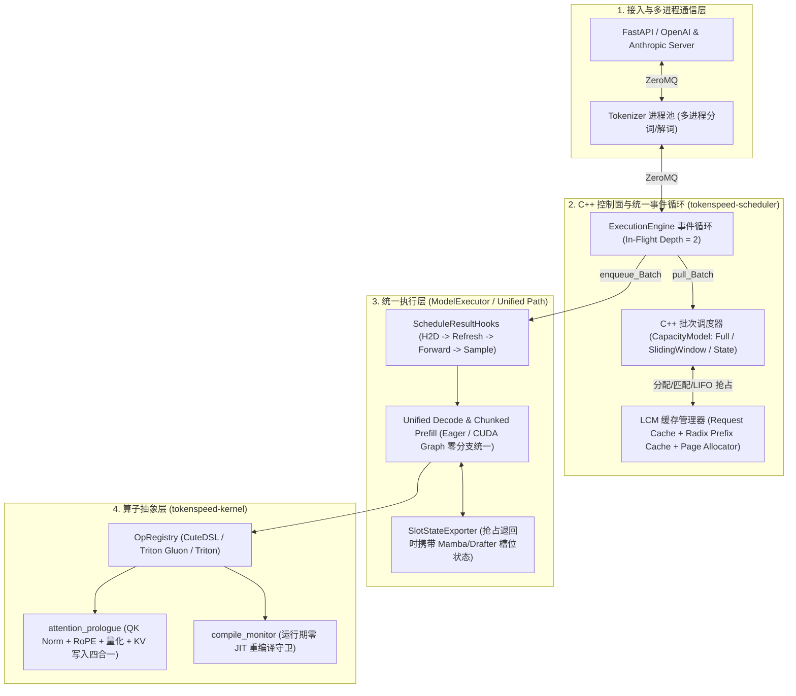
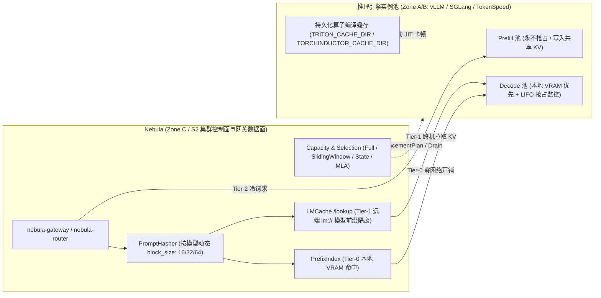

# TokenSpeed 架构剖析与 Nebula 演进对标

> **定位**：本文档剖析高性能单引擎推理系统 **TokenSpeed**（Zone A/B：单实例调度、LCM 缓存子系统、算子内联与编译监控）的核心设计哲学，与 **Nebula**（Zone C / S2：跨引擎黑盒之上的集群池化、前缀亲和路由、分层 KV 治理与闭环容量控制）进行全方位对标，并记录 Nebula 从 TokenSpeed 吸收并落地的四项核心架构优化。

---

## 一、TokenSpeed 核心架构剖析（Zone A/B 引擎内核设计）

TokenSpeed 是面向现代大模型（DeepSeek-V3/R1 MLA + MoE、Qwen3/3.5 Gated DeltaNet 混合线性注意力、MTP/EAGLE3 树形投机采样）构建的极致低开销推理引擎。其整体架构由四个强约束子系统组成：

### 1. 统一单路径原则（One Scheduling Path & One Execution Path）

TokenSpeed 严格禁止在主干代码中为不同运行模式编写平行分支：
- **PD 分离与混部同构**：Prefill-Only、Decode-Only 与混部（Normal）共享同一个 C++ `Scheduler` 与 Python `ExecutionEngine`，仅通过引擎角色配置区分 admission 与退回策略。
- **Eager 与 CUDA Graph 同构（Unified Decode Path）**：所有注意力后端遵循统一的“三步式元数据契约”（`prepare_decode` 分配最大固定缓冲 $\rightarrow$ `capture` 录制静态地址 $\rightarrow$ `refresh` 原地刷新 `seq_lens` 与 `block_table`）。无论是否开启 CUDA Graph，每步 Decode 均只执行 `refresh + replay/forward`。
- **链式与树形投机采样同构（Tree Speculation as Chain Compaction）**：MTP / EAGLE3 树形投机在进入模型前通过 `tree_spec_compact` 折叠进主序列缓冲，复用同一套 `positions`（RoPE 树深）与 `slots`（KV 物理槽位）张量，验证采样后通过 `tree_spec_decompact` 原地还原。

### 2. 三层解耦的缓存词汇表（Cache Concepts）与多粒度缓存组

TokenSpeed 将 KV 缓存拆解为职责严格正交的三层：
1. **Request Cache（请求槽位表）**：每个在途请求占用 1 个 `request_slot`，行宽对齐至 `page_table_width_Alignment`，仅在请求活跃期间存在。
2. **Prefix Cache（Radix 前缀树）**：工作在 **`prefix_granularity`（前缀匹配粒度，如 64 tokens）** 上，负责跨请求复用已计算的 KV 前缀并维护引用计数（Ref-Count > 0 不可驱逐，Ref-Count = 0 进入 LRU 可驱逐池）。
3. **Page Allocator（物理页分配器）**：工作在注意力内核要求的 **`num_tokens_per_page`（物理页粒度，如 16、32、64 tokens）** 上。满足不变量 `prefix_granularity % num_tokens_per_page == 0`。

在此基础上，混合架构模型的不同层被注册为独立的 **Cache Group**，由 C++ `CapacityModel` 按三类数学公式统一核算单步新增分配需求：
- **`kFull`（全历史注意力，如 MHA / GQA / MLA）**：随序列长度线性增长，$\text{pages}(L) = \lceil L / g \rceil$。
- **`kSlidingWindow`（滑动窗口注意力）**：物理存活窗口上限为 $W + V - 1$（$W$ 为窗口大小，$V$ 为单步验证 token 数 `DraftWindowTokens`），过期完整页在 `free_Expired_Sliding_Window_Blocks` 中自动释放，永不随长上下文无限膨胀。
- **`kState`（循环/线性状态层，如 Mamba2 / Qwen3.5 Gated DeltaNet）**：不存历史 token KV，每个请求固定占用 **2 个物理状态槽位**（1 个工作槽 + 1 个投机接受检查点槽），单步增量恒为 0。

### 3. 控制面/数据面解耦与抢占恢复协议（Retraction & Recovery）

- **单飞/双飞流水线（`in_flight_batches = 2`）**：主线程在 GPU 执行 Batch $N$ 的同时，通过 C++ 调度器预取并准备 Batch $N+1$ 的主机侧张量，使 GPU 侧无气泡。
- **角色感知的抢占（Retraction）不变量**：
  - **Prefill 实例永不抢占**：Prefill 请求只跑一次前向即交出 KV，且无增量输出进度；若空闲页不足，Prefill 调度器直接停止拉取新请求，绝不驱逐已入批请求。
  - **Decode 实例 LIFO 尾部抢占**：当在途请求跨过页边界导致空闲页不足时，C++ 调度器从运行队列**尾部（LIFO，最年轻请求）**开始回收，将已生成 token 拼回 `prompt_tokens`，并通过 Python 侧 `SlotStateExporter` 协议将 Drafter/Mamba 等槽位私有状态随请求快照一并保存，待页恢复后无缝续跑。

### 4. 算子边界与运行期零 JIT 重编译守卫（`compile_monitor`）

- **`attention_prologue` 四合一融合**：将投影层（QKV Gemm）与核心 Attention 之间的 QK RMSNorm、RoPE、FP8/BF16 类型转换及 Paged KV Cache 写入收敛为唯一算子入口，消除碎片化的小算子启动开销。
- **`compile_monitor` 零运行期编译停顿**：严禁将随批次动态变化的标量（如 `num_tokens`、`batch_size`、`max_seq_len`、动态 stride）标记为 `tl.constexpr`。上线预热完成后开启监控，任何运行期触发的 Triton/JIT 重编译（会导致 100ms+ 的前向卡顿）都会被直接捕获并在 CI 中报错。

---

## 二、TokenSpeed 与 Nebula 的架构对标：Zone A/B vs Zone C/S2

TokenSpeed 与 Nebula 并非同类替代关系，而是**上下游互补、设计哲学高度同构**的两层系统：

| 对比维度 | TokenSpeed（Zone A/B：单实例执行内核） | Nebula（Zone C / S2：跨引擎集群池化层） | Nebula 可吸收的架构精髓 |
| :--- | :--- | :--- | :--- |
| **系统定位** | 单副本（含 TP/EP/DP）极致吞吐与低延迟的推理引擎 | 跨多节点、多引擎（vLLM / SGLang / TokenSpeed）的池化控制面与智能数据面网关 | 将 TokenSpeed 作为高优先级一等公民引擎接入 Nebula 观测与治理体系 |
| **单路径收敛** | Prefill / Decode / Speculation / CUDA Graph 共享唯一调度与执行路径 | `replicated` 与 `pd_split` 共享统一 `Router::route_internal` 与 `PlacementPlan` 调谐环 | 消除控制面与数据面对 `/lookup` 响应的双解析器分裂，收敛为单一公共契约 |
| **缓存粒度契约** | 显式区分 `prefix_granularity`（前缀哈希粒度）与 `num_tokens_per_page`（物理页粒度） | `PromptHasher` 原先固定按 16 tokens 切块哈希，未随模型 `block_size`（如 MLA 64 tokens）动态对齐 | 让 `PromptHasher`、`Router` 与 `PrefixAffinity` 按模型配置的 `block_size` 动态切块与记账 |
| **多级局部性** | GPU HBM 页表 $\rightarrow$ Radix Prefix Cache（引用计数保活 + LRU 驱逐） | Tier-0 Decode 本地 VRAM 命中（`scoped_prefix_owner`）$\rightarrow$ Tier-1 `LMCacheServer` 远端 `lm://` 命中 $\rightarrow$ Tier-2 Prefill 重算 | 在 `pd_split` 远端命中时隔离跨模型前缀污染，并补齐远端 KV 命中的 `saved_prefill_tokens` 记账 |
| **KV 容量建模** | C++ `CapacityModel` 原生区分 `kFull`、`kSlidingWindow`、`kState`（2-slot）三类层 | `selection.rs` 原先按均匀全注意力层估算高并发与长上下文显存压力 | 在选型与容量画像中引入 `Full / SlidingWindow / State / MLA` 混合注意力 KV 显存估算模型 |
| **防运行期抖动** | `compile_monitor` 严禁运行期 Triton JIT 重编译，启动期完成全部编译预热 | 容器/Pod 重建时若未持久化 Triton/Inductor 编译缓存，首波流量会遭遇数十秒 JIT 重编译停顿 | 在节点与 K8s 引擎拉起路径中默认挂载持久化 `TRITON_CACHE_DIR` 与 `TORCHINDUCTOR_CACHE_DIR` |

---

## 三、Nebula 吸收 TokenSpeed 设计的四项优化落地

遵循 Nebula `docs/ai/agents/engineering.md` 的 **Zone C 边界原则（Constraints over Coupling）** 与 **零幻觉代码原则（Zero Hallucination Code）**，我们将从 TokenSpeed 提炼的四项设计优化直接落入 Nebula 核心 crate：

### 1. 按模型动态对齐 `block_size`（对应 TokenSpeed `prefix_granularity`）

**问题背景**：
传统 GQA 模型在 vLLM 中默认使用 `block_size = 16`，但 DeepSeek-V3/R1（MLA）及 TokenSpeed / SGLang 的 Radix 树通常采用 `block_size = 64`（或 `32`）。原先 `PromptHasher`（`[prompt_hash.rs](../../crates/nebula-router/src/prompt_hash.rs)`）、`Router::route_internal` 的短请求旁路判断（`hs.len() * 16 < bypass_tokens`）、`saved_prefill_tokens` 记账（`blocks * 16`）以及 `PrefixAffinity` 的联合代价模型（`[strategy.rs](../../crates/nebula-router/src/strategy.rs)` 中 `matched_blocks * 16.0`）全部硬编码为 `16`。当模型配置了 `block_size = 64` 时，路由侧的块哈希边界与引擎侧实际 KV 块边界失配，且节省的 Prefill Token 数被低估 4 倍。

**落地方案**：
1. **`PromptHasher` 动态块粒度表**：在 `[prompt_hash.rs](../../crates/nebula-router/src/prompt_hash.rs)` 的 `PromptHasher` 中新增 `model_block_sizes: DashMap<String, usize>`，提供 `set_model_block_size`、`clear_model_block_size`、`block_size_for` 与 `hashes_from_ids_for_model(model_uid, ids)`；未显式配置时保持默认 `DEFAULT_BLOCK_SIZE = 16`。
2. **`Router` 模型注册联动与代价传递**：在 `[lib.rs](../../crates/nebula-router/src/lib.rs)` 的 `Router::register_model_spec` 与 `clear_model_mappings` 中自动同步 `ModelConfig.block_size`；在 `body_route_hints`、`is_short_prompt` 判定、`record_saved_prefill_tokens` 以及传给 `SelectionCtx.block_size`（`[strategy.rs](../../crates/nebula-router/src/strategy.rs)` 的 `PrefixAffinity::select`）中全面使用该模型的真实 `block_size`。
3. **部署前契约校验增强**：在 `[model_deployment.rs](../../crates/nebula-common/src/model_deployment.rs)` 的 `validate_pd_split_with_context` 中，补齐对 `topology == Replicated && kv_sharing.is_some()` 的显式错误拦截（修复原先返回 `Ok(())` 却在执行面静默丢弃 `kv_sharing` 配置的问题），同时为 `pd_split` v1 保留严格的 `block_size == 16` LMCache 兼容门禁。

### 2. `pd_split` 远端 `/lookup` 解析收敛、模型前缀隔离与远端省算力记账

**问题背景**：
1. 控制面 `[lmcache.rs](../../crates/nebula-control/src/lmcache.rs)` 实现了按 `{model_uid}-` 过滤实例名的 `max_matched_tokens_for_model`，但数据面 `[lib.rs](../../crates/nebula-router/src/lib.rs)` 的 `Router::controller_warm` 仍使用未过滤的私有 `max_matched_tokens`，在多模型共享同一 `LMCacheController` 时会把其他模型的缓存误判为当前模型命中。
2. 在 `pd_split` 形态下，`LMCacheConnectorV1` 会关闭引擎侧 ZMQ `kv-events`，导致纯远端 `lm://` 命中时 `scoped_prefix_matches` 为空，`nebula_router_saved_prefill_tokens_total` 恒为 0。

**落地方案**：
1. **统一解析函数下沉至 `nebula-common`**：在 `[model_deployment.rs](../../crates/nebula-common/src/model_deployment.rs)` 中提供公共函数 `max_matched_tokens_for_model` 与 `max_matched_tokens`，由 `nebula-control` 与 `nebula-router` 共同调用，消除双解析器分裂。
2. **模型级 `/lookup` 命中 Token 缓存与省算力记账**：`Router::controller_warm_tokens`（及兼容包装 `Router::controller_warm`）在 `pd_warm_cache` 中直接缓存匹配的 Token 数量 `u64`，并记录按 `(model_uid, first_block_hash)` 索引的远端命中深度；当 `pd_split` 请求路由至 Decode 副本且无本地 ZMQ `scoped_prefix_matches` 命中时，按远端命中的真实 Token 数累加 `saved_prefill_tokens`。

### 3. 三类注意力 KV 容量模型（`Full` / `SlidingWindow` / `State`）与选型评估

**问题背景**：
借鉴 TokenSpeed `CapacityModel` 对 `kFull`、`kSlidingWindow`（窗口上限 $W$）和 `kState`（Mamba / Gated DeltaNet 恒定 2-slot 状态检查点）的精确区分，Nebula 的模型画像与选型器（`[selection.rs](../../crates/nebula-common/src/selection.rs)`）需要识别现代混合注意力与 MLA 架构在长上下文和高并发下的真实 KV 显存缩放律，而非将所有层一视同仁视为全历史 MHA/GQA。

**落地方案**：
1. 在 `[selection.rs](../../crates/nebula-common/src/selection.rs)` 的 `ModelArchitecture` 中新增可选几何字段：
   - `sliding_window_tokens: Option<u32>`（滑动窗口注意力的窗口上限 $W$）
   - `linear_attention_layer_ratio: Option<f64>`（Mamba2 / Gated DeltaNet 等线性/循环状态层占比 $\in [0.0, 1.0]$，其 KV 状态开销不随序列长度增长，仅占固定 2-slot 检查点）
   - `kv_lora_rank: Option<u32>`（DeepSeek MLA 压缩潜向量秩，用于刻画 MLA 相对标准 GQA 的 KV 显存缩减）
2. 新增纯函数 `estimate_kv_cache_vram_mb(profile: &ModelProfile, concurrency: u32, context_len: u32) -> f64` 与混合注意力并发效率修正，并在 `recommend_models` 选型评分中对长上下文场景下的混合注意力/MLA 模型给予可解释的容量与并发优势加分。

### 4. 执行面持久化算子编译缓存与 TokenSpeed 引擎原生接入

**问题背景**：
1. TokenSpeed 的 `compile_monitor` 揭示了运行期 Triton / TorchInductor / DeepGEMM 编译会导致百毫秒级前向停顿，且容器重启若丢失 JIT 缓存会反复触发冷启动编译风暴。
2. Nebula 的指标采集器 `[engine_metrics.rs](../../crates/nebula-common/src/engine_metrics.rs)` 与能力矩阵 `[capability.rs](../../crates/nebula-common/src/capability.rs)` 需要原生识别 `tokenspeed` 引擎命名空间及其 LIFO 抢占指标。

**落地方案**：
1. **持久化 JIT 缓存目录注入**：在 `[vllm.rs](../../crates/nebula-node/src/engine/vllm.rs)`、`[tokenspeed.rs](../../crates/nebula-node/src/engine/tokenspeed.rs)`（Docker 容器启动参数）与 `[main.rs](../../crates/nebula-k8s-controller/src/main.rs)`（K8s Pod 环境变量）中，将 `TRITON_CACHE_DIR` 与 `TORCHINDUCTOR_CACHE_DIR` 指向已挂载的模型持久化缓存卷（`/model/.cache/...` 或 `/models/weights/.cache/...`），确保跨容器/Pod 重建复用已编译的 GPU 内核二进制。
2. **`tokenspeed` 一等公民引擎全链路接入**：
   - **能力与兼容矩阵**：将 `"tokenspeed"` 注册进 `[capability.rs](../../crates/nebula-common/src/capability.rs)` 的 `KNOWN_ENGINE_TYPES`，声明 `static_capability_tokenspeed()` 与 `static_version_support("tokenspeed")`（校验拒绝不支持的 LoRA 与 `ngram` 投机采样），并在 `[compat.rs](../../crates/nebula-common/src/compat.rs)` 的默认兼容矩阵中新增 `tokenspeed-nvidia-cuda` 规则。
   - **原生 CLI 参数编码**：在 `[engine_args.rs](../../crates/nebula-common/src/engine_args.rs)` 中实现 `build_tokenspeed_extra_args`，将 `ModelConfig` 精确编码为 TokenSpeed `ServerArgs` 原生标志（如 `block_size` -> `--prefix-granularity`、`Mtp` -> `--speculative-algorithm NEXTN` 等）。
   - **Node 与 K8s 引擎执行器**：新增 `[tokenspeed.rs](../../crates/nebula-node/src/engine/tokenspeed.rs)`（`TokenspeedEngine`，支持本地进程组 `tokenspeed serve` 与 Docker 容器模式、容器复用、健康检查、运行期能力发现 `[discover.rs](../../crates/nebula-node/src/engine/discover.rs)` 与镜像 GC 识别 `[image_manager.rs](../../crates/nebula-node/src/image_manager.rs)`），并在 `[main.rs](../../crates/nebula-k8s-controller/src/main.rs)` 的 `create_engine_pod` 中支持拉起 TokenSpeed K8s Pod。
   - **Prometheus 指标与抢占诊断**：在 `[engine_metrics.rs](../../crates/nebula-common/src/engine_metrics.rs)` 的 `parse_engine_metrics` 与 `parse_engine_scrape_diagnostics` 中原生解析 `tokenspeed:` / `tokenspeed_` 指标前缀（含等待队列、运行队列、KV 使用率、前缀缓存命中率与 `num_preemptions_total` 抢占计数）。

### 5. 队头阻塞（HoL Waiting）与运行批（Running Batch）解耦及抢占（Preemption）感知路由

**问题背景**：
借鉴 TokenSpeed `[docs/design/scheduler.md]` §1.1（`holdsHeadOfLine`）与 §2（LIFO Retraction）：
1. **Waiting 与 Running 的本质差异**：处于 `num_requests_running` 的请求已在 GPU 连续批处理（Continuous Batching）中并行执行，边际排队开销较低；而处于 `num_requests_waiting` 的请求意味着副本正被未完成的分块 Prefill 队头阻塞（HoL Blocked）或因 KV 满载无法准入。原本 Nebula 将二者简单相加为 `pending_requests`，丢失了 HoL 阻塞信号。
2. **LIFO 抢占（Preemption/Retraction）抖动感知**：当 Decode 阶段 KV 增长耗尽空闲页时，引擎会触发 LIFO 撤回/抢占（`num_preemptions_total`）。正在发生抢占的副本处于 KV 颠簸状态，路由与容量视图需显式感知。

**落地方案**：
1. **`EndpointStats` 细粒度队列与抢占字段**：在 `[endpoint.rs](../../crates/nebula-common/src/endpoint.rs)` 与 `[engine_metrics.rs](../../crates/nebula-common/src/engine_metrics.rs)` 中保留 `pending_requests = waiting + running` 向后兼容的同时，新增可选字段 `waiting_requests`、`running_requests` 与 `num_preemptions_total`。
2. **HoL 感知负载均衡与联合代价函数**（`[strategy.rs](../../crates/nebula-router/src/strategy.rs)`）：
   - `LeastPending` 在总 `pending_requests` 相同时，优先选择 `waiting_requests` 更低（无 HoL 阻塞）且 `kv_cache_usage` 更低的副本。
   - `PrefixAffinity` 对 `waiting_requests` 施加更高的队头等待惩罚（`QUEUE_WAIT_COST_PER_WAITING = 96.0` vs `QUEUE_WAIT_COST_PER_PENDING = 64.0`），并对发生 KV 抢占（`num_preemptions_total > 0`）的副本施加 `PREEMPTION_PENALTY_WEIGHT = 32.0` 惩罚。
3. **优雅缩容与容量告警**：`[scale.rs](../../crates/nebula-scheduler/src/scale.rs)` 缩容时在同等 `pending_requests` 下优先摘除 `running_requests` 更低的副本；`[capacity.rs](../../crates/nebula-common/src/capacity.rs)` 在检测到 `preemptions_total > 0` 时输出 `kv_preemptions_detected` 告警。

### 6. 前缀重放尾边界（`prefix_replay_tokens >= 1`）与 Prompt Logprobs 缓存旁路

**问题背景**：
借鉴 TokenSpeed `[docs/design/scheduler.md]` §1（"What the probe may claim"）：
1. **末尾 Token 必重算规则（`prefix_replay_tokens >= 1`）**：无论前缀缓存命中率多高，引擎至少必须重算 Prompt 的最后一个 Token 以生成首个输出 Token 的 Logits，因此长度为 $L$ 的 Prompt 最多只能节省 $L - 1$ 个 Prefill Token。此外，此前 `pd_warm_cache` 仅缓存 `(bool, u64)`，在 2 秒 TTL 命中时会把匹配数放大为整个 `token_ids.len()`。
2. **Prompt Logprobs 无法命中无 Logits 的 KV 缓存**：当请求携带 `echo: true` 或 `prompt_logprobs > 0` 时，缓存的 KV 页不包含历史位置的 Logits，引擎必须作为普通 Prefill 重新计算；且在 `pd_split` 架构下，Decode 节点不负责计算 Prompt 阶段 Logprobs。

**落地方案**：
1. 在 `[lib.rs](../../crates/nebula-router/src/lib.rs)` 中将 `pd_warm_cache` 升级为直接存储精确匹配 Token 数 `(u64, u64)`，并在 `controller_warm_tokens` 中以 `token_ids.len().saturating_sub(1)` 作为可复用上限（`max_replayable`）。
2. 新增 `Router::body_requires_prompt_logits(body)` 检测 `echo == true` 或 `prompt_logprobs > 0`：一旦命中，`body_route_hints` 直接返回 `(None, false)`，确保在 `pd_split` 下强制路由至 Prefill 池计算完整 Prompt Logits，且不虚增 `saved_prefill_tokens`。
