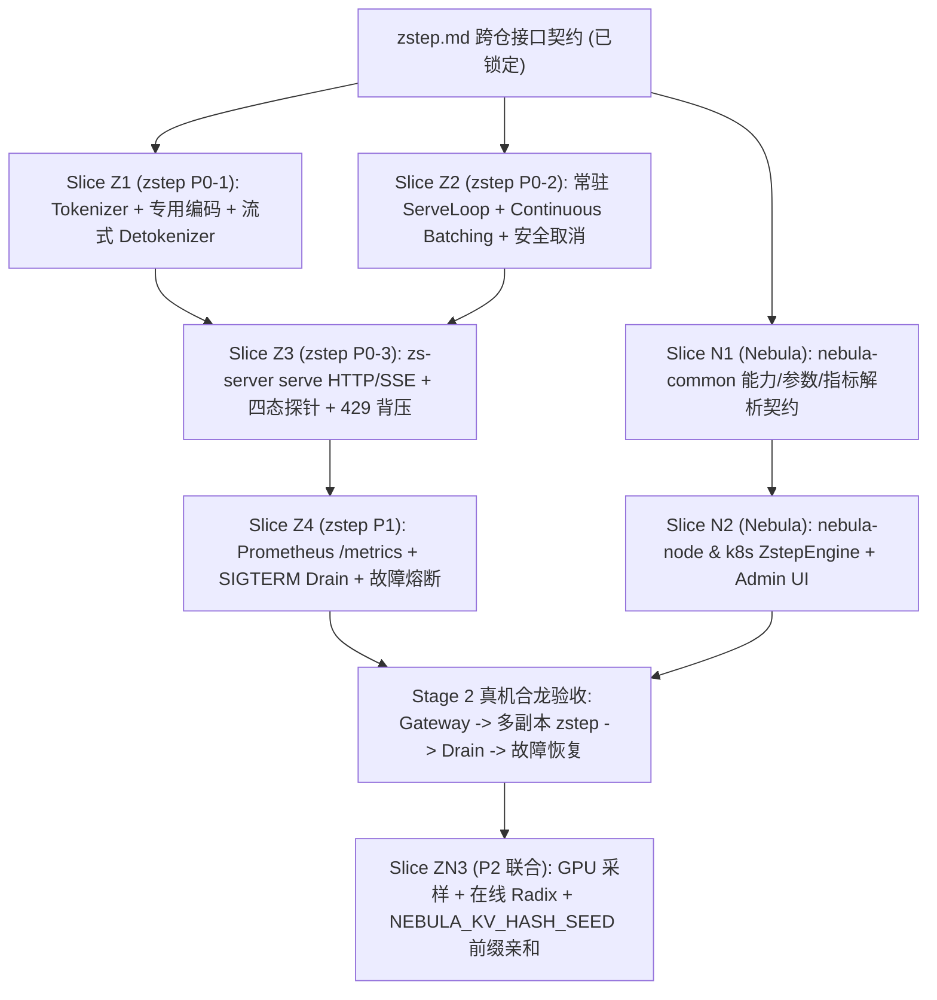

# zstep 在线化与 Nebula 原生纳管联合开发计划

> **状态**：待执行（供独立编码 Agent / DeepSeek 按切片交付）  
> **绑定契约**：[`zstep.md`](./zstep.md)（CLI 参数表、四态探针状态码、`429/503` 错误语义、`/metrics` 字段、P2 KV 事件）  
> **关联需求**：`EeroEternal/zstep#7`（引擎侧在线化）与 `EeroEternal/nebula#92`（平台侧 `engine_type = "zstep"` 纳管）

---

## 1. 并行协作与零冲突隔离红线（必读）

当前推理内核与算子性能优化线正在并行推进。执行本计划时**必须遵守以下物理边界，严禁制造跨线代码冲突**：

1. **`zstep` 热路径算子与离线评测零侵入**：
   - 在线服务能力必须落入**新增模块或新 crate**（如 `crates/zs-tokenizer`、`crates/zs-scheduler/src/serve_loop.rs`、`crates/zs-server/src/serve.rs`）。
   - **禁止重写或改动** `worker/zstep_worker/kernels_sm120/`、`worker/zstep_worker/models/deepseek_v41.py`、`qwen35_moe.py` 的算子/前向逻辑（P2 采样扩展除外）。
   - 现有的离线评测入口 `zs-server --mode-b --bench-tiers` / `--verify-greedy-json` 与 `crates/zs-scheduler/src/serving.rs` 必须保持 100% 兼容与性能零退化；复用 `SlotPool` / 页表同步辅助函数时仅做最小 `pub(crate)` 暴露。
2. **Nebula Zone C 铁律（[`AGENTS.md`](../../AGENTS.md)）**：
   - Nebula 只通过 CLI 参数、HTTP/SSE、`/health`、`/metrics` 与可选 ZMQ KV 事件管理 `zstep` 黑盒，绝不触碰 SHM 或 KV 字节。
   - Nebula 任何代码提交 push 前必须在本地跑过 `./scripts/ci.sh` + `cargo fmt --check` + `cargo clippy` + 前端检查（不得新增 GitHub Actions 测试流）。
3. **禁止幻觉能力与静默忽略**：
   - 未实现的 OpenAI 参数或 `ModelConfig` 字段必须显式返回 `400` 拒绝；未接入在线 Radix 前严禁在 `/metrics` 输出 `zstep:prefix_cache_* = 0`。

---

## 2. 切片拆解与依赖拓扑（7 个独立 PR）

由于跨仓契约已在 [`zstep.md`](./zstep.md) 锁死，**Nebula 侧的 `Slice N1` / `Slice N2`（基于 Mock HTTP 契约）可与 `zstep` 侧 `Slice Z1–Z4` 完全并行开发**，最后在真机合龙。

---

## 3. 各切片交付范围与确定性验收门禁

### Slice Z1（`zstep` 仓）：Tokenizer、Chat Template 与流式停止器

- **范围**：
  - 新增 `crates/zs-tokenizer`（或 `zs-server` 独立子模块），加载模型目录 `tokenizer.json` / `tokenizer_config.json`。
  - 支持通用 Chat Template（`system`/`user`/`assistant`/`tool`）及 `--tokenizer-mode deepseek_v41` 专用 `encode_messages()`（严禁用通用 Jinja 近似替代）。
  - 实现增量流式解码器：处理跨 Token 不完整 UTF-8 多字节序列、过滤 Special Token、跨 chunk 滑动窗口检测 `stop` 字符串并精确截断（不含 `stop` 本身）。
  - 校验 `prompt_tokens.len() + max_tokens <= max_model_len`（超限返结构化错误供上层映射 `400 context_length_exceeded`）。
- **门禁**：
  - 固定 Token-ID Trace 黄金测试：对比 HF / vLLM 参考输出，Prompt Token IDs 与停止位置 100% 逐位一致；
  - 构造中文/Emoji 多字节拆包与跨 chunk `stop` 字符串边界单测全绿。

### Slice Z2（`zstep` 仓）：常驻 `ServeLoop` 在线调度与 Step 边界取消

- **范围**：
  - 新增 `crates/zs-scheduler/src/serve_loop.rs`，封装专用常驻线程驱动 `ModeBCoordinator`。
  - 通过有界 `crossbeam`/`tokio::sync::mpsc` 接收在线请求，维护 `waiting_queue` 与 `active_sequences`，原子更新 `waiting_count`、`running_count`、`available_kv_pages`。
  - 保持稳态纯 Decode `in_flight_depth = 1` 双槽 overlap 与新请求到达时的顺风车混合步（`max_mixed_step_tokens`）。
  - 终态条件：`Length`（`max_tokens`）、`StopToken`（EOS / 模型停止词）、`StopString`、`Cancelled`（客户端断连 / 超时）、`Failed`。
  - **安全取消**：检测到请求取消标志后，在当前 in-flight Step 收敛边界移除序列，`Drop` 释放 `SlotLease` 与 `BlockLease`，将 `shadow_page_table` 对应槽位行刷回 `dummy_page` 并置位 `dirty_pt_slots[0..2]`。
  - **故障传染阻断**：任一 Worker 退出、返回 `WORKER_STATUS_ERROR` 或心跳超时，立即置全局状态为 `Faulted`，唤醒所有等待/在途请求返回 `engine_faulted`，拒绝后续调度。
- **门禁**：
  - 并发混合长度请求动态加入与提前结束单测；
  - 随机时刻取消 50% 在途 Prefill/Decode 请求后，断言 `slot_pool.available() == slot_pool.capacity()` 且 `kv_pool.available() == kv_pool.capacity()`（零槽位与物理页泄漏）。

### Slice Z3（`zstep` 仓）：`zs-server serve` OpenAI HTTP/SSE 与四态探针

- **范围**：
  - 新增 `crates/zs-server/src/serve.rs`（基于 `axum`），暴露 CLI `zs-server serve`（参数严格对齐 [`zstep.md` §2](./zstep.md#2-启动入口cli-参数与运行环境契约)）。
  - 实现 `GET /v1/models`、`POST /v1/chat/completions`（`stream=true/false`、`max_tokens`、`stop`、`seed`、`stream_options.include_usage`；对未支持参数如非零采样/tools 显式返 `400 invalid_parameter`）。
  - 实现 [`zstep.md` §3](./zstep.md#3-生命周期状态机与探针状态码契约) 四态探针：`GET /livez`、`GET /health`、`GET /ready`、`POST /admin/drain`（特别注意：**`Starting` 期 `/health` 与 `/v1/models` 同返 `503`；`Draining` 期 `/health` 保持 `200` 而 `/ready`、`/v1/models` 与新请求返 `503`**）。
  - 背压与错误码对齐 [`zstep.md` §4.2](./zstep.md#42-过载429与实例不可用503严格区分)：等待队列满或 KV 不足返 **`429`**（`engine_overloaded`），**严禁返 `503`**；每条 SSE 流配独立有界输出队列，防止慢客户端撑爆内存，且 `data: [DONE]\n\n` 严格只发一次。
  - 请求 ID 按 `x-nebula-request-id` $\rightarrow$ `x-request-id` $\rightarrow$ 自生成顺序提取并贯穿结构化日志。
- **门禁**：
  - 自动化 HTTP 集成测试覆盖：四态探针矩阵、SSE `[DONE]` 唯一性、客户端断连自动触发 `ServeLoop` 取消、满载 `429`、未知参数 `400`。

### Slice Z4（`zstep` 仓）：Prometheus `/metrics` 与 `SIGTERM` 优雅排空

- **范围**：
  - 实现 `GET /metrics`，精确输出 [`zstep.md` §5](./zstep.md#5-prometheus-metrics-与-stats-抓取契约) 定义的 `zstep:num_requests_waiting`、`zstep:num_requests_running`、`zstep:kv_cache_usage_perc`、`zstep:num_preemptions_total`、TTFT/TPOT 直方图、`zstep:request_outcomes_total` 与 `zstep:triton_recompilations_total`。
  - 捕获 `SIGTERM` / `SIGINT`：自动转入 `Draining`，停止接收新请求，轮询等待 `waiting + running == 0`（或达 `--drain-timeout-secs` 上限）后有序关闭 Worker 并 `shm_unlink`。
  - 启动期记录完整 Provenance（Git SHA、模型、TP、`b12x` 状态、SHM 几何参数）。
- **门禁**：
  - 真机启动单模型，压测并发流式请求期间发送 `SIGTERM`：在途流 100% 正常收尾退出、新请求返 `503`、退出后 `/dev/shm` 零残留、`triton_recompilations_total == 0`；
  - 对比相同 Prompt 与 Token-ID Trace 下在线 `zs-server serve` 与离线 Mode B 吞吐/TPOT 偏差在合理 HTTP/SSE 开销范围内。

### Slice N1（`nebula` 仓）：`nebula-common` 控制面与指标解析契约

- **范围**：
  - [`capability.rs`](../../crates/nebula-common/src/capability.rs)：`KNOWN_ENGINE_TYPES` 加入 `"zstep"`，实现 `static_capability_zstep()`（P0/P1：`tool_calling = Unsupported`, `score_api = Unsupported`, `lora = Some(false)`, `pending_requests = Supported`, `kv_cache_usage = Supported`, `prefix_cache_hit_rate = Unsupported`），放开 [`capability.rs:406`](../../crates/nebula-common/src/capability.rs#L406) 使 `"zstep"` 支持 `max_num_seqs`（`1..=128`）、`max_num_batched_tokens`、`enable_chunked_prefill`。
  - [`engine_args.rs`](../../crates/nebula-common/src/engine_args.rs)：实现 `build_zstep_extra_args`（按 [`zstep.md` §2.2](./zstep.md#22-modelconfig-rightarrow-build_zstep_extra_args-编码映射) 编码）。
  - [`engine_metrics.rs`](../../crates/nebula-common/src/engine_metrics.rs)：实现 `parse_zstep_metrics_text` 并接入 `parse_engine_metrics` 与 `parse_engine_scrape_diagnostics`。
  - [`compat.rs`](../../crates/nebula-common/src/compat.rs)：新增 `zstep-nvidia-cuda` 默认兼容规则。
- **门禁**：
  - `cargo test -p nebula-common` 覆盖全部新增标志映射、非法参数拒绝（如 `lora_modules`、`max_num_seqs > 128`）及 `/metrics` 解析（验证无 `prefix_cache_*` 时 `prefix_cache_hit_rate == None`）。

### Slice N2（`nebula` 仓）：双执行面 `ZstepEngine`、Admin UI 与全栈合龙

- **范围**：
  - 新增 `crates/nebula-node/src/engine/zstep.rs`（参照 [`tokenspeed.rs`](../../crates/nebula-node/src/engine/tokenspeed.rs)，支持 Docker `--ipc=host` + 本地进程组模式，注入 `TRITON_CACHE_DIR` / `TORCHINDUCTOR_CACHE_DIR` / `FLASHINFER_WORKSPACE_BASE`），并接入 [`mod.rs`](../../crates/nebula-node/src/engine/mod.rs)、[`args.rs`](../../crates/nebula-node/src/args.rs)、[`discover.rs`](../../crates/nebula-node/src/engine/discover.rs)、[`image_manager.rs`](../../crates/nebula-node/src/image_manager.rs)。
  - [`crates/nebula-k8s-controller/src/main.rs`](../../crates/nebula-k8s-controller/src/main.rs)：`create_engine_pod` 增加 `is_zstep` 分支（入口 `["zs-server", "serve"]`，端口 `43537`，复用 16Gi `/dev/shm` 内存卷）。
  - 前端控制台：在 [`LoadModelDialog.tsx`](../../frontend/src/components/LoadModelDialog.tsx)、[`images.tsx`](../../frontend/src/components/views/images.tsx) 与 [`i18n.tsx`](../../frontend/src/lib/i18n.tsx) 增加 `zstep` 引擎选项与双语词条（遵守 `AGENTS.md` UI 与 i18n 规范）。
- **门禁**：
  - 本地全量门禁 `./scripts/ci.sh` + `cargo clippy --workspace --all-targets -- -D warnings` + 前端类型/构建检查 100% 通过；
  - **真机合龙四项必测**：
    1. 通过 Nebula 部署 2 个 `zstep` 副本（如 `replica_specs` 指定 `gpu_indices`），确认 `/endpoints/` 注册 `ready` 且 `/stats/` 实时刷新 `pending_requests` 与 `kv_cache_usage`；
    2. 经 Nebula Gateway 发起并发流式/非流式请求与中途断连取消，核对无 `5xx` 误报、无 KV/Slot 泄漏；
    3. 触发副本缩容（`2 -> 1`），确认走完 `Draining -> pending_requests == 0 -> SIGTERM -> /dev/shm 零残留` 闭环；
    4. `kill -9` 某副本单个 GPU Worker，确认 `zstep` `/health` 变 `503` $\rightarrow$ Nebula 自动摘流重启恢复。

### Slice ZN3（P2 跨仓增强）：采样扩展、在线 Radix 与 `nebula-indexd` 前缀亲和

- **范围**：
  - `zstep` 在 `zs-wire` `StepPlan` 增加 per-slot `(temperature, top_p, top_k, seed)` 并在 Worker GPU 侧完成采样；
  - `zstep` `ServeLoop` 接入 `zs_kv::KvCacheManager`（Radix Prefix Cache），开启 `zstep:prefix_cache_{hits,queries}_total` 指标；
  - `zstep` 实现 [`zstep.md` §6](./zstep.md#6-p2-跨副本前缀亲和事件契约nebula_kv_hash_seed) 的 `NEBULA_KV_HASH_SEED` 16-token `sha256_cbor` 块哈希与 ZMQ `BlockStored`/`BlockRemoved` 事件发布；`nebula-node` / `nebula-k8s-controller` 在配置 `NEBULA_KV_EVENTS_ENDPOINT` 时为 `zstep` 自动注入 `--kv-events-endpoint` 与 `--kv-events-topic`。
- **门禁**：
  - 单元校准测试验证 `zstep` 产出的 8 字节块哈希与 [`kv_hash.rs`](../../crates/nebula-router/src/kv_hash.rs) 在相同 Token 序列和种子下 100% 逐字节相等；
  - 多副本 `PrefixAffinity` 压测验证共享前缀命中路由与 Goodput 提升。
