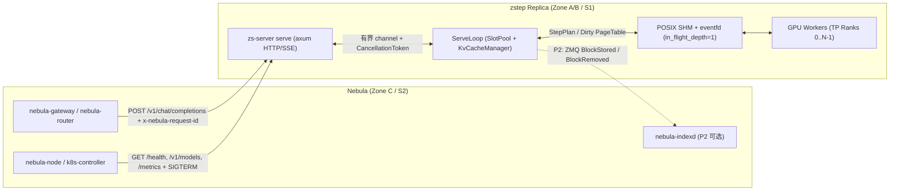

# zstep 引擎接入与跨仓接口契约

> **状态**：**阶段 1（契约）与阶段 2（Slice N1/N2 运行时接入）已实现；P2 在线 Radix 前缀事件待接线**。[`KNOWN_ENGINE_TYPES`](../../crates/nebula-common/src/capability.rs) 已纳管 `zstep`（与 `vllm`、`sglang`、`tokenspeed` 并列）；`zstep` 侧在线 `serve` 子命令实现于 `EeroEternal/zstep#9`（跟踪于 `EeroEternal/zstep#7`）。本文钉死双仓在 CLI 参数、探针状态码、HTTP/SSE 错误语义、Prometheus `/metrics` 与 P2 KV 事件上的精确契约，作为两边实现与联调的唯一依据。

---

## 1. 架构边界与职责切分（Zone A/B vs Zone C）

遵循 [`AGENTS.md`](../../AGENTS.md) 第 13/14 条与 [`direction.md`](./direction.md) §10.2：

- **`zstep`（Zone A/B / S1，单节点引擎黑盒）**：Rust Master 独占单实例 HTTP/SSE、Tokenizer/Chat Template、请求状态机、有界等待队列、`SlotLease`/`BlockLease` RAII、Radix Prefix Cache 与 Mode B `SHM + eventfd`（`in_flight_depth = 1`）双槽流水线，驱动本机多卡 GPU Worker（CUDA Graph / `b12x` / SM120 算子）。不实现多机网关或跨副本路由。
- **`Nebula`（Zone C / S2，跨副本编排与治理面）**：把每个完整 `zstep` TP 实例作为独立普通副本（`Standalone` / `Replicated`）纳管，负责租户鉴权与配额、网关有界公平准入、跨副本 `PrefixAffinity` / `LeastPending` 选路、健康探测、优雅排空（Drain）与故障重启。**绝不读写 `zstep` 的 POSIX SHM、不触碰 KV 字节、不介入逐 Step 调度**。

---

## 2. 启动入口、CLI 参数与运行环境契约

### 2.1 `zs-server serve` 基础启动形态

`zstep` 新增在线服务入口 `zs-server serve`（保留原 `--mode-b` 离线基准测试入口不变），默认必须支持以下基础标志：

| `zs-server serve` 参数 | 必填 | 默认值 / 要求 | Nebula 注入方 |
| :--- | :--- | :--- | :--- |
| `--model-dir <PATH>` | 是 | 本地权重与 `tokenizer.json` 目录（容器内 `/model` 或 `/models/weights`） | `nebula-node` / `k8s-controller` |
| `--served-model-name <ID>` | 否 | 默认取目录名；下发时必须作为 `/v1/models` 返回的 `data[0].id` | `ModelConfig.served_model_name` 或 `model_uid` |
| `--host <IP>` | 否 | **必须显式传 `0.0.0.0`**（避免容器/Pod IP 不可达，见 [`engines.md`](./engines.md) §4） | `nebula-node` / `k8s-controller` |
| `--port <PORT>` | 是 | Node 动态分配空闲端口；K8s Pod 固定 `43537` | `nebula-node` / `k8s-controller` |

### 2.2 `ModelConfig` $\rightarrow$ `build_zstep_extra_args` 编码映射

在 [`engine_args.rs`](../../crates/nebula-common/src/engine_args.rs) 与 [`capability.rs`](../../crates/nebula-common/src/capability.rs) `validate_model_config` 中按如下契约编码与校验（禁止把 vLLM 专属标志透传给 `zstep`）：

| `ModelConfig` 字段 | `zstep` CLI 映射 | 准入校验规则（`validate_model_config`） |
| :--- | :--- | :--- |
| `tensor_parallel_size` | `--world-size <N>` | 支持 `1..=8`；若 `gpu_indices.len() > 1` 且未显式指定，由 `nebula-node` 按卡数自动推导 |
| `gpu_memory_utilization` | `--gpu-memory-utilization <F>` | `(0.0, 1.0]`，由 `zstep` 启动期换算物理 `--num-kv-pages` |
| `max_model_len` | `--max-model-len <N>` | `>= 1`，`zstep` 据此换算 `--max-pages-per-seq = ceil(max_model_len / page_block_tokens)` 并校验 Prompt 上限 |
| `max_num_seqs` | `--max-seqs <N>` | [`capability.rs:450`](../../crates/nebula-common/src/capability.rs#L450) 允许 `vllm` 与 `zstep`；`zstep` 要求 `1..=128`（对齐 `MAX_DECODE_GRAPH_SEQS`） |
| `max_num_batched_tokens` | `--max-step-tokens <N>` | `>= max_num_seqs`，映射至 `ShmGeometry.max_step_tokens` 与混合步预算 |
| `enable_chunked_prefill` | `false` 时传 `--max-prefill-chunk <max_model_len>` | 默认开启（`2048`）；显式 `false` 时要求 `max_num_batched_tokens >= max_model_len` |
| `block_size` | `--page-block-tokens <N>` | 默认 `16`；配置后同步至 Router `PromptHasher` 动态块粒度表 |
| `kv_cache_dtype` | `--kv-cache-dtype <DTYPE>` | 如 `bf16` / `fp8` |
| `tokenizer_mode` | `--tokenizer-mode <MODE>` | 如 `auto` / `deepseek_v41`（强制启用专用 `encode_messages` 而非通用 Jinja） |
| `enable_prefix_caching` | `--enable-prefix-caching` / `--no-enable-prefix-caching` | P0/P1 若尚未接线 Radix，传 `true` 时在启动期明确报错拒绝，禁止静默忽略 |
| `lora_modules` | 无 | `static_capability_zstep().lora = Some(false)`，非空时在控制面直接 `400` 拒绝 |
| `speculative_config` | P0/P1 暂不映射 | 未支持的方法在 `validate_model_config` 显式拒绝 |
| `trust_remote_code` / `enable_expert_parallel` | 忽略（不报错） | `zstep` 模型路由与 MoE EP 由原生算子内建，无需 Python `trust_remote_code` |

### 2.3 执行面进程、`/dev/shm` 与算子缓存契约

1. **POSIX 共享内存容量**：
   - `zstep` Mode B 在 `/dev/shm` 中分配双槽 `StepPlan`、KV 页表与跨卡 AllReduce 缓冲区。
   - `nebula-node` Docker 模式必须携带 `--ipc=host`（与 [`tokenspeed.rs:194`](../../crates/nebula-node/src/engine/tokenspeed.rs#L194) 一致）；K8s Pod 继续挂载 `emptyDir: { medium: "Memory", sizeLimit: "16Gi" }` 到 `/dev/shm`（[`nebula-k8s-controller/src/main.rs:962`](../../crates/nebula-k8s-controller/src/main.rs#L962) 已具备）。
2. **持久化编译与产物缓存**：
   - 容器与 Pod 默认注入持久化卷下的环境变量，避免重建时重复触发 Triton / `b12x` 编译卡顿：
     - `HF_HOME`、`TRITON_CACHE_DIR`、`TORCHINDUCTOR_CACHE_DIR`
     - `FLASHINFER_WORKSPACE_BASE=<cache_root>/flashinfer`（供 `b12x` SM120 cubin/workspace 复用）
3. **进程组与 `/dev/shm` 零残留**：
   - 本地裸机模式通过 [`configure_process_group`](../../crates/nebula-node/src/engine/mod.rs#L143) 放入独立进程组，`stop` 时发送 `SIGTERM`（10s 宽限期后 `SIGKILL`）。
   - `zstep` Master 捕获 `SIGTERM` / `SIGINT` 后必须走正常 `Drop` 路径调用 `shm_unlink` 并回收全部 Worker 子进程，保证 `/dev/shm` 零残留。

---

## 3. 生命周期状态机与探针状态码契约

> **关键源码约束（由现有 Nebula 实现决定）**：
> 1. [`wait_engine_ready`](../../crates/nebula-node/src/engine/mod.rs#L244-L279) 同时轮询 `GET /health` 与 `GET /v1/models`，**任一返回 `2xx`（且 `/v1/models` 含非空 `data[0].id`）即判定启动就绪**。
> 2. [`heartbeat.rs:485-556`](../../crates/nebula-node/src/heartbeat.rs#L485-L556) **仅在 `health_check`（`GET /health`）返回 `true` 时才执行 `scrape_stats` 更新 `/stats/` 中的 `pending_requests`**；若 `Draining` 期间 `/health` 返回 `503`，会导致：① `/stats/` 停止刷新使 [`drain_then_stop`](../../crates/nebula-node/src/reconcile.rs#L261) 卡满 `DRAIN_TIMEOUT_MS`，② 连续 5 次失败触发 `RESTART_THRESHOLD` 误重启正在排空的副本。

因此，`zstep` 必须严格按以下四态矩阵返回 HTTP 状态码：

| 实例状态 | 触发条件 | `GET /livez` | `GET /health`（供 Nebula Node/K8s 心跳） | `GET /ready`（供外部 LB / K8s Readiness） | `GET /v1/models` | `POST /v1/chat/completions` |
| :--- | :--- | :---: | :---: | :---: | :---: | :---: |
| **`Starting`** | 加载配置/权重/`b12x`、拉起 Worker、Warmup & Graph Capture 未完成 | `200` | **`503`** | `503` | **`503`** | `503` (`engine_starting`) |
| **`Ready`** | Warmup 完成且所有 Worker 心跳正常 | `200` | **`200`** | **`200`** | **`200`** | 正常准入（满载返 **`429`**） |
| **`Draining`** | 收到 `SIGTERM` 或 `POST /admin/drain`；等待在途请求归零 | `200` | **`200`** `{"status":"draining"}` | **`503`** | **`503`** | **`503`** (`engine_draining`) |
| **`Faulted`** | 任一 Worker 子进程退出、`WORKER_STATUS_ERROR`、心跳超时或 SHM abort | `200`（Master 存活） | **`503`** `{"status":"faulted"}` | `503` | `503` | **`503`** (`engine_faulted`) |

**为什么这套状态码与 Nebula 完全闭环**：
- **启动期**：`/health` 与 `/v1/models` 同返 `503`，`wait_engine_ready` 严格等到 CUDA Graph 录制与 Warmup 结束才将副本注册为 `Ready`。
- **缩容 Drain 期**：Nebula 先在 etcd 将端点标为 `EndpointStatus::Draining`（Router 立即摘流），同时 `zstep` 收到信号后在 `/health` 保持 `200`（使 `heartbeat.rs` 保留 `EndpointStatus::Draining` 并持续抓取 `/metrics` 直至 `pending_requests == 0`），而对任何在途竞态到达的新推理请求返回 `503`（触发 Gateway [`proxy_common.rs:672`](../../crates/nebula-gateway/src/proxy_common.rs#L672) 自动重试到其它健康副本），并在 `/v1/models` 返回 `503`（防止 [`try_reuse`](../../crates/nebula-node/src/engine/tokenspeed.rs#L318) 误复用正在退出的容器）。
- **故障期**：一旦 Worker 崩溃或卡死，`/health` 立即变 `503`，`heartbeat.rs` 连续探测失败后自动标记 `Unhealthy` 并按退避预算重启副本。

---

## 4. 数据面 HTTP/SSE、过载错误码与取消契约

### 4.1 请求追踪 Header 对齐

Nebula Gateway 在转发上游请求时通过 [`inject_execution_context`](../../crates/nebula-common/src/execution_context.rs#L134) 与 `inject_trace_context` 注入上下文头。`zstep` 按以下优先级提取请求 ID，写入响应 `id`（或 `x-request-id` 响应头）并贯穿 Master/Worker 结构化日志：

1. `x-nebula-request-id`（Nebula 标准请求 ID，如 `req_<uuid>`）
2. `x-request-id`（直连或第三方网关请求 ID）
3. 未携带时自生成 `chatcmpl-<uuid>`
4. 同时透传记录 W3C `traceparent`（若存在）

### 4.2 过载（`429`）与实例不可用（`503`）严格区分

Gateway 在 [`proxy_common.rs:672-684`](../../crates/nebula-gateway/src/proxy_common.rs#L672-L684) 对所有上游 `5xx` 执行 `router.record_endpoint_failure(...)`（累加端点熔断计数）并计入 `upstream_5xx` 错误预算；对客户端 JSON 错误按 [`contracts.md`](./contracts.md) C3 原样透传。因此 `zstep` 必须区分：

| 场景 | HTTP 状态码 | OpenAI 错误 JSON（`error.type` / `error.code`） | Gateway 行为 |
| :--- | :---: | :--- | :--- |
| 参数非法 / 超最大上下文 `max_model_len` / 不支持的参数 | `400` | `invalid_request_error` / `context_length_exceeded` 或 `invalid_parameter` | 原样透传客户端，不熔断、不重试 |
| 请求体超上限 | `413` | `invalid_request_error` / `payload_too_large` | 原样透传客户端 |
| **等待队列满 / `SlotPool` 满 / `BlockPool` KV 容量不足** | **`429`** | `rate_limit_error` / `engine_overloaded` | **不触发端点故障熔断、不烧 `5xx` 预算** |
| 实例处于 `Starting` / `Draining` / `Faulted` | **`503`** | `server_error` / `engine_starting` \| `engine_draining` \| `engine_faulted` | 记端点不可用并自动换副本重试 |

### 4.3 流式 SSE 与 Step 边界安全取消

1. **流式首包与结束语义**：
   - `stream=true` 返回 `200 OK`、`Content-Type: text/event-stream`、`Cache-Control: no-cache`。
   - 为配合 Nebula [`first_chunk_of`](../../crates/nebula-gateway/src/proxy_common.rs#L710) 的首字节超时保护，不在排队阶段刷空注释帧保活；进入生成或首 Token 产出时发送首个 `chat.completion.chunk`（含 `role: "assistant"`）。
   - 每个请求状态机终态唯一：`data: [DONE]\n\n` **至多发送一次**；若请求支持 `stream_options.include_usage = true`，在 `[DONE]` 前发送最后一个 `choices: []` 且含精确 `usage` 的 chunk。
2. **客户端断连与慢客户端背压（[`contracts.md`](./contracts.md) C2）**：
   - 每个流式请求绑定有界 `mpsc::channel(N)`（如 `64` chunks）。
   - 客户端主动断开（Gateway 关闭上游连接导致 `axum` Body `Drop`）或慢客户端写通道持续满超时，立即触发该请求的取消标记。
   - `ServeLoop` 在**当前正在执行的 GPU Step 完成后**移除该 `ActiveSequence`，通过 RAII `Drop` 归还 `SlotLease` 与全部 `BlockLease`，并将 `shadow_page_table` 对应槽位行重置为 `dummy_page`、置位双缓冲 `dirty_pt_slots`，确保对同批其它请求零干扰、KV 与槽位零泄漏。

---

## 5. Prometheus `/metrics` 与 `/stats/` 抓取契约

`zstep` 在 `GET /metrics` 暴露标准 Prometheus 文本格式，命名空间统一为 `zstep:`（[`extract_ns_metric`](../../crates/nebula-common/src/engine_metrics.rs#L106) 同时兼容 `zstep_`）：

| `zstep` `/metrics` 指标名 | 类型 | 精确定义 | 映射至 Nebula [`EndpointStats`](../../crates/nebula-common/src/endpoint.rs) / 诊断 |
| :--- | :--- | :--- | :--- |
| `zstep:num_requests_waiting` | Gauge | 已通过 HTTP 校验并在 `ServeLoop` 等待队列中尚未分配 `SlotLease` 的请求数 | `waiting_requests`；计入 `pending_requests`（高权重 HoL 惩罚） |
| `zstep:num_requests_running` | Gauge | 当前持有 `SlotLease`（处于 `Prefilling` + `Decoding`）的活跃序列数 | `running_requests`；`pending_requests = waiting + running` |
| `zstep:kv_cache_usage_perc` | Gauge | `[0.0, 1.0]`：`1.0 - (kv_pool.available() as f64 / kv_pool.capacity() as f64)` | `kv_cache_usage`（驱动 `0.95` 过载保护与 `0.85` 扩容建议） |
| `zstep:num_preemptions_total` | Counter | 因 Decode 页耗尽触发的序列撤回/重算累计次数（无抢占实现前恒为 `0`） | `num_preemptions_total`（驱动路由抢占避让与容量告警） |
| `zstep:prefix_cache_queries_total` | Counter | **仅当在线启用 `KvCacheManager` Radix 时暴露**：前缀树查询累计请求数 | `prefix_cache_queries_total` |
| `zstep:prefix_cache_hits_total` | Counter | **仅当在线启用 `KvCacheManager` Radix 时暴露**：命中的前缀 Token（或块）累计数，同单位相除得命中率 | 与 `queries_total` 计算 `prefix_cache_hit_rate` |
| `zstep:time_to_first_token_seconds` | Histogram | 从请求进入引擎至首 Token 产出的耗时直方图 | Prometheus / 观测面板抓取 |
| `zstep:time_per_output_token_seconds` | Histogram | Decode 阶段逐 Token 间隔耗时直方图 | Prometheus / 观测面板抓取 |
| `zstep:request_outcomes_total{outcome=...}` | Counter | `outcome` $\in$ `{"finished","cancelled","rejected_overloaded","failed"}` | 实例级 SLO 与取消率核对 |
| `zstep:triton_recompilations_total` | Gauge/Counter | 运行期算子 JIT 重编译次数（稳态期望恒为 `0`） | 运行期性能退化诊断 |

> **三态铁律（[`stats.md`](./stats.md)）**：P0/P1 尚未在线启用 Radix Prefix Cache 时，`zstep` **不得输出** `zstep:prefix_cache_*` 行，使 `parse_zstep_metrics_text` 解析出 `prefix_cache_hit_rate = None`（UI 显示 `n/a`），严禁输出 `0` 伪装已支持但零命中。

---

## 6. P2 跨副本前缀亲和事件契约（`NEBULA_KV_HASH_SEED`）

当 `zstep` 在 P2 在线启用 [`zs-kv`](https://github.com/EeroEternal/zstep) Radix Prefix Cache 时，无需任何网关侧定制即可直接接入 Nebula 现成的 [`kv_hash.rs`](../../crates/nebula-router/src/kv_hash.rs)、[`kv_events.rs`](../../crates/nebula-router/src/kv_events.rs) 与 [`nebula-indexd`](../../crates/nebula-router/src/bin/indexd.rs)：

1. **块哈希同源公式**：
   - 读取环境变量 `NEBULA_KV_HASH_SEED`（缺省 `"42"`），计算根种子哈希 `NONE_HASH = sha256_cbor_text(seed)`。
   - 按 `page_block_tokens`（默认 `16`）切分完整 Token 块（忽略末尾不足一整块的余数），逐块链式计算 `h_i = sha256(cbor_canonical([parent_bytes_32, [tok_0, ..., tok_{B-1}], null]))`，取末尾 8 字节大端 `h_i[24..32]` 作为外部块键。
2. **ZMQ 事件帧格式**：
   - 当传入 `--kv-events-endpoint <zmq_addr>` 与 `--kv-events-topic "{model_uid}/{replica_id}"` 时，`zstep` 通过 ZMQ `PUB`/`PUSH` 发送两帧消息：`frame[0] = topic.as_bytes()`，`frame[1] = msgpack([timestamp_f64, [event, ...]])`：
     - 块提交进 Radix 树：`{"type": "BlockStored", "block_hashes": [bin_8_or_32, ...], "medium": "GPU"}`
     - LRU 驱逐出 Radix 树：`{"type": "BlockRemoved", "block_hashes": [bin_8_or_32, ...]}`
     - 实例重置清空：`{"type": "AllBlocksCleared"}`

---

## 7. Nebula 侧代码落点清单（阶段 2 实施范围）

Postgres（`nebula-bff`）中 `engine_type` 均为无约束 `TEXT` 列并统一委托 [`validate_engine_and_config`](../../crates/nebula-common/src/capability.rs#L627) 校验，**无需任何 SQL 迁移**。接入 `engine_type = "zstep"` 的完整改动范围固定为：

1. [`crates/nebula-common/src/capability.rs`](../../crates/nebula-common/src/capability.rs)：`KNOWN_ENGINE_TYPES` 加入 `"zstep"`，实现 `static_capability_zstep()`、`static_version_support("zstep")`，并在 `validate_model_config` 允许 `"zstep"` 使用 `max_num_seqs` / `max_num_batched_tokens` / `enable_chunked_prefill`。
2. [`crates/nebula-common/src/engine_args.rs`](../../crates/nebula-common/src/engine_args.rs)：实现 `build_zstep_extra_args` 及单测。
3. [`crates/nebula-common/src/engine_metrics.rs`](../../crates/nebula-common/src/engine_metrics.rs)：实现 `parse_zstep_metrics_text` 并接入 `parse_engine_metrics` 与 `parse_engine_scrape_diagnostics`。
4. [`crates/nebula-common/src/compat.rs`](../../crates/nebula-common/src/compat.rs)：新增 `zstep-nvidia-cuda` 默认兼容矩阵规则。
5. [`crates/nebula-node/src/engine/`](../../crates/nebula-node/src/engine/mod.rs) + [`args.rs`](../../crates/nebula-node/src/args.rs) + [`discover.rs`](../../crates/nebula-node/src/engine/discover.rs) + [`image_manager.rs`](../../crates/nebula-node/src/image_manager.rs)：新增 `zstep.rs`（`ZstepEngine`，含 `--ipc=host` 与 `FLASHINFER_WORKSPACE_BASE` 缓存挂载）。
6. [`crates/nebula-k8s-controller/src/main.rs`](../../crates/nebula-k8s-controller/src/main.rs)：`create_engine_pod` 增加 `is_zstep` 镜像、入口 `["zs-server", "serve"]` 与环境变量分支。
7. [`frontend/src/components/LoadModelDialog.tsx`](../../frontend/src/components/LoadModelDialog.tsx) 与 [`frontend/src/components/views/images.tsx`](../../frontend/src/components/views/images.tsx)：补齐 `zstep` 引擎选择项与下拉项。
